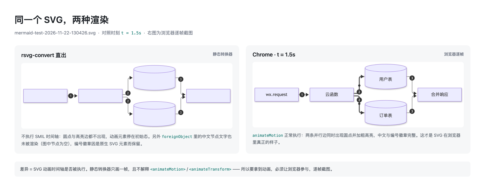
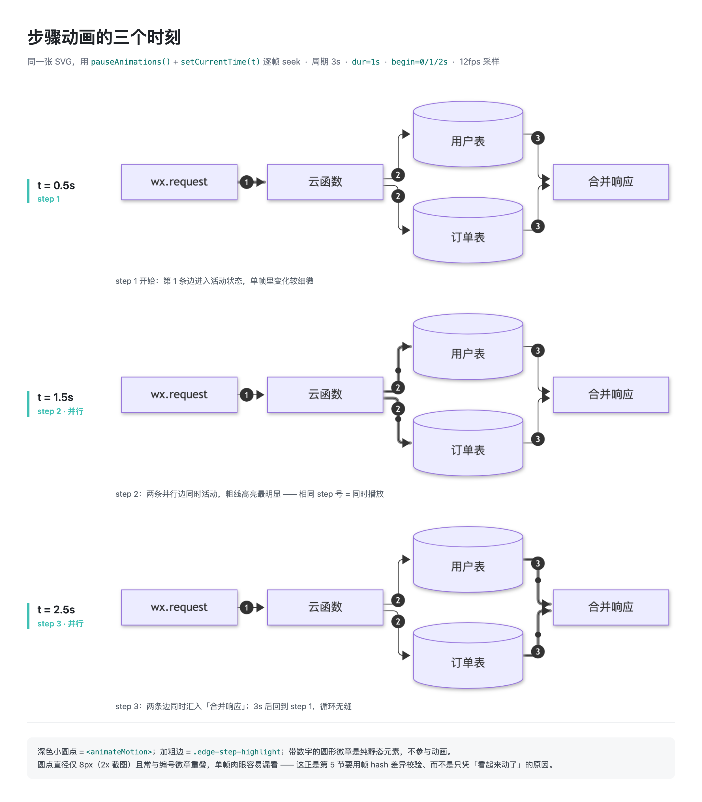

:author: https://github.com/wangzhaohe/swot-learning
:source-highlighter: pygments
:icons: font
:font-size: 16px
:scripts: cjk
:stem: latexmath
:experimental:
:toc:
:toc: right
:toc-title: 目录
:toclevels: 3
:tip-caption: ⚡
:note-caption: ❕
:important-caption: ❗
:caution-caption: ⚠️
:warning-caption: ‼️

= SVG 里的动画，到底是谁在播？

// 只有当后端不是 pdf or github 时才包含以下内容
ifndef::env-github[]
ifndef::backend-pdf[]
++++
<style>
/* 1. 默认状态：初始就是隐藏的 */
#toc {
    max-width: 0 !important;
    opacity: 0 !important;
    padding-left: 0 !important;
    padding-right: 0 !important;
    border: none !important;
    overflow: hidden !important; /* 必须在这里，保证收缩时内容不溢出 */
    white-space: nowrap !important;

    /* 【关键】：过渡动画必须放在基类里，这样“展开”和“收回”都有动画 */
    transition: max-width 0.3s cubic-bezier(0.4, 0, 0.2, 1),
                padding 0.3s cubic-bezier(0.4, 0, 0.2, 1),
                opacity 0.3s ease;
}

/* 2. 展开状态：点击后添加 .active 或 .expanded 类 */
#toc.active {
    max-width: 530px !important;
    opacity: 1 !important;
    padding: 10px !important; /* 根据需要恢复 padding */
    overflow-y: auto !important;
}

/* 3. 列表样式保持不变 */
#toc ul, #toc li {
    margin-bottom: 8px !important;
    line-height: 1.4 !important;
}
</style>

<button id="toggleButton">Open Toc</button>
<div id="toc">
    </div>

<script>
const toggleButton = document.getElementById('toggleButton');
const contentDiv = document.getElementById('toc');

toggleButton.addEventListener('click', () => {
    // 切换 active 类
    const isExpanded = contentDiv.classList.toggle('active');

    // 逻辑：如果现在是 expanded (true)，说明打开了，按钮应该提示“收起”
    toggleButton.textContent = isExpanded ? 'Close TOC' : 'Open TOC';
});
</script>
++++
endif::[]
endif::[]

== 说明：mermaid 生成的 svg 在浏览器里可以显示
[NOTE]
====
- 是对 workbuddy 把 svg 图片转为 gif 文件的剖析。
- 生成 svg 动画的文档参考 xref:mermaid-animateMotion.adoc[ mermaid support animateMotion ]
====

做课件时需要一张能讲「请求顺序」的图：点登录 → 拿 code → 换 openid → 渲染登录态。Mermaid 的步骤动画正好能沿边依次播放，我给三条边标上 step 1/2/3，再用命令行工具 mmdc 导出成 SVG。

文件落到磁盘上，我断言「静态导出物不会动」。在 Chrome 里打开，圆点在边上跑了起来。这句话错在把「导出成文件」当成了「变成静态」：SVG 可以自带动画声明，浏览器打开时照样执行；只有转成 PNG 那一类栅格格式，才真的定格一帧。后来要把这张图放进 PPT，才遇到第二个问题：怎么把浏览器里的时间轴，变成一帧帧脱离浏览器也能播的位图。

这篇记的是后一件事。先分清动画是谁在播，再从 SVG 源码里把时间轴读出来，最后逐帧导出并验证。

=== 先看一张对照

[width="100%",cols="20%,20%,20%,20%,20%",options="header",]
|===
|机制 |声明写在哪 |谁执行 |`` 引入时 |本例中的对应
|SMIL |`<animateMotion>` / `<animateTransform>` 等元素 |浏览器 SVG 引擎 |照跑 |圆点移动、当前边高亮
|CSS |SVG 内 `<style>` + `@keyframes` / `@media` |浏览器 CSS 引擎 |照跑 |虚线流动、减少动态效果时隐藏
|JavaScript |`<script>` 或外部 mermaid.js |JS 引擎 |被禁用 |本例不用
|===

前两种是**自包含**的：动画声明就在 `.svg` 文件里，不需要 Mermaid 运行时。所以 Chrome 直接打开会动，用 `` 引进网页通常也会动——图片上下文只禁脚本，不禁 SMIL 和 CSS。

== 1. 动画写在 SVG 里，不在 mmdc 里

**定位** 先确定执行主体。`mmdc` 把 Mermaid 源码渲染成一份 SVG 文本，写完文件就退出；浏览器打开这份 SVG 时才解析其中的动画声明。把 SVG 换成 GIF，不是「让动画动起来」，而是把浏览器已经会播的时间轴，改成一帧帧位图。

**做法** 打开导出的 SVG，能找到三处声明：

```xml
<!-- 圆点沿边移动：SMIL -->
<circle class='edge-step-dot' r='4' transform='translate(164,118.6) scale(0)'>
  <animateMotion begin='0s;step_..._e1_step.end+2s' dur='1s'
                  id='step_..._e1_step' path='M164,118.6L200,118.6'/>
  <animateTransform attributeName='transform' type='scale' values='1;1' dur='1s'/>
</circle>
```

```css
/* 当前边高亮，以及减少动态效果时隐藏 */
.edge-step-highlight { stroke-width: 4; stroke-opacity: .6; }
  #my-svg .edge-step-dot, #my-svg .edge-step-highlight { display: none; }
}
```

编号徽章则是纯静态元素，没有任何动画属性：

```xml
<g class='edge-step-badge' data-step='1'><circle r='9'/><text>1</text></g>
```

**边界** 徽章正因为不参与动画，成了唯一在所有环境都稳的顺序标记。`@keyframes dash` 那条虚线流动是 CSS 动画，跟步骤动画无关，别混为一谈。另外节点里的中文在 `<foreignObject>` 里，是 HTML 文本而不是 SVG 原生 `<text>`——这一点在第 2 节会变成关键差异。

**检验方法** `grep -oE "animateMotion|@keyframes|<script" x.svg`。命中 SMIL 或 CSS、又没有 `<script>`，就说明这份 SVG 自包含，不需要 mermaid.js 也能动。

== 2. 静态转换器为什么不行
**定位** 拿到自包含 SVG，最省事的想法是让 `rsvg-convert`、`cairosvg` 或 ImageMagick 直接转。它们不实现 SVG 动画时间轴，只按当前 DOM 状态画一帧。

**做法** 用同一个文件直出一次（把路径换成自己的 SVG）：

```bash
rsvg-convert -w 1472 your.svg -o /tmp/direct.png
```

.同一个 SVG，静态转换器直出与浏览器逐帧的对照


**边界** 实测结果比「少了动画」更糟：`rsvg-convert` 也不渲染 `<foreignObject>` 里的 HTML 文本，节点里的中文全空；编号徽章因为是原生 `<circle><text>`，反而留下来了。判断依据不是「看着不像」，而是转换器根本不解释 `<animateMotion>`，动画元素停在 `scale(0)` 的初始态。图 2 左右两栏把这点摆在一起。

所以要拿到动画，只能让浏览器参与，逐帧截图。

**检验方法** 把直出图和浏览器帧并排看（图 2）。节点文字为空、又没有加粗边，就说明转换器没跑时间轴；这时调它的参数没有意义。

== 3. 读时间轴：周期不是查来的
*定位* 决定 GIF 截多久的是循环周期。这个值不在文档里，也不在命令行参数里，写在 SVG 的 `begin` 和 `dur` 上。

*做法* 从源码摘出一条边：

[source,xml]
----
<animateMotion begin='0s;step_..._e1_step.end+2s' dur='1s' id='step_..._e1_step' .../>
----

[cols=",,",options="header",]
|===
|读到的东西 |值 |推出的结论
|`dur` |`1s` |每条边播 1 秒
|首次 `begin` |`0s` / `1s` / `2s` |三步依次开始
|重复基准 |`id.end + 2s` |自身结束后再等 2 秒
|单条边周期 |`1 + 2 = 3s` |每 3 秒重播一次
|整体 |`0, 1, 2, 3, 4, 5 …` |每秒换一步，无停顿，3 秒一轮
|===

取 0–3 秒做循环，第 3 秒正好回到 step 1，首尾无缝。图 1 是同一张图在 0.5 / 1.5 / 2.5 秒的三帧。

.步骤动画的三个时刻


*边界* 相同 step 号表示同时播放，不是顺序播放：并行分支里两条边都标 `step: 2`，会一起亮。若动画改由 CSS 写，这套读法要换成 `animation-duration` 与 `animation-iteration-count`，先确认执行主体再读参数。

*检验方法* 换一张图，先 `grep -o "begin='[^']*'" x.svg` 看重复基准是不是 `id.end+Ns`；是，周期就是 `dur + N`。

== 4. 逐帧采样的两个判断
**定位** 有了周期，还要决定怎么把时间轴变成确定的帧序列。

**做法** 核心只有四行：

```js
await page.emulateMediaFeatures([{ name: 'prefers-reduced-motion', value: 'no-preference' }]);
await page.evaluate(() => document.querySelector('svg').pauseAnimations());
await page.evaluate(t => document.querySelector('svg').setCurrentTime(t), i / FPS);
await el.screenshot({ path: `f_${String(i).padStart(3, '0')}.png` });
```

再交给 ffmpeg 合成：

```bash
ffmpeg -framerate 12 -i f_%03d.png \
  -filter_complex '[0:v]split[a][b];[a]palettegen=stats_mode=full[p];[b][p]paletteuse=dither=sierra2_4a' \
  -loop 0 -gifflags +transdiff out.gif
```

**边界** 三个容易漏掉的点：

A. `prefers-reduced-motion` 必须显式设为 `no-preference`。SVG 里那条 `@media` 会在 reduce 时把圆点和高亮 `display:none`，不报错、不提示，转出来就是一张静态图。
B. 用 `setCurrentTime(t)` 而不是 `sleep`。截图本身要几十毫秒，靠睡眠采帧会让间隔漂移，循环接缝顿一下；seek 是确定性的，同一时刻重截得到同一帧。
C. 独立 SVG 文档里 `document.documentElement` 就是根 `<svg>`，把 width/height 钉到 viewBox 尺寸能去掉多余留白；`width='100%'` 在独立文档里会按视口撑开。

**检验方法** 截 0.3 / 1.3 / 2.3 秒三帧比 hash，再回到 0.3 秒比一次。前三帧互不相同、首尾一致，说明 seek 生效。

== 5. 验证：别只看退出码 0
**定位** 上面每一步都可能「成功但没做对」，需要三层验证。

**做法** 第一层查产物结构：

```bash
ffprobe -v error -select_streams v:0 \
  -show_entries stream=nb_frames,width,height -show_entries format=duration \
  -of default=nw=1 out.gif
```

本次三张产物都是 36 帧 / 3.000s，尺寸 1928×170、1928×170、1472×458，29–46 KB。

第二层查帧 hash：36 帧里分别有 30、27、34 帧互不相同。若只有一两种帧，动画根本没跑起来，第 4 节那个 reduced-motion 是最常见的元凶。

第三层抽首、中、尾帧肉眼看。

**边界** 这一层也纠正了我的一个想当然：圆点 `r=4`，2x 截图里只有 8px，还常和编号徽章叠在一起，单帧几乎看不见；稳定可辨的是当前边被加粗高亮。所以「看起来动了」不能当判据，帧 hash 差异才是。图 1 的图注写明了这点。

**检验方法** 三层里任一层不过就停：帧数不对查采样循环，hash 只有一两种回去查 reduced-motion，肉眼看不出变化就把图放大看当前边的加粗高亮。

== 6. 什么时候留 SVG，什么时候出 GIF
**定位** 决定产物的不是清晰度，是目标环境有没有 SVG 运行时。

**做法** 按目标环境选：

| 环境  | 动画  | 编号徽章 | 用哪个 |
| --- | --- | --- | --- |
| Chrome 直接打开 `.svg` | 动   | 在   | 留 SVG |
| 网页 `` / inline SVG | 动   | 在   | 留 SVG |
| `mmdc -o x.png` | 定格  | 在   | 讲义截图 |
| PPT / Word / PDF / 打印 | 定格  | 在   | 出 GIF |
| 微信、公众号等只认位图的地方 | 定格  | 在   | 出 GIF |
| GIF 逐帧位图 | 动   | 在   | 任何环境 |
| 系统开「减少动态效果」 | 圆点与高亮被隐藏 | 在   | 靠徽章 |

**边界** 系统偏好只影响 SVG 里那条 CSS 规则，GIF 是位图，不受影响。所以「徽章在所有环境都在」这句结论，正是靠它不参与动画得到的。GIF 的价值不是「更清楚的 SVG」，而是不依赖 SVG 运行时。

**检验方法** 把文件插进目标环境看一眼。PPT、Word、PDF、打印预览这些地方，SVG 动画一律定格，别指望它。

== 7. 怎么做
[upperalpha]
. 先 `grep` 确认动画机制是 SMIL / CSS 还是 JS，判断 SVG 是否自包含。
. 从 `begin` / `dur` 推出循环周期，别凭感觉定 GIF 时长。
. 用浏览器逐帧 seek，显式关掉 reduced-motion；别用 sleep，也别用静态转换器。
. `ffprobe` 查帧数与时长 → 帧 hash 查差异 → 抽帧肉眼看。
. 网页留 SVG，PPT / Word / 公众号出 GIF；讲义再单独出一张 PNG。
. 版本细节照文末备注核一遍，别只报 `mmdc --version`。

== 附录 A：课堂用法
讲义要的是顺序，课堂演示要的是过程，两者对产物的要求正好相反。下面这段 Mermaid 源码开了 `stepNumbers`，把它存成 `login.mmd` 后按目标环境分别导出：

> 下面用了 mermaid 12.3.0 的步骤动画语法。掘金内置 Mermaid 版本较旧，标 `mermaid` 会渲染失败，这里按纯代码展示；要看效果贴到 mermaid.live 或用本地 `mmdc` 出图。

```text
---
config:
  flowchart:
    stepNumbers: true
---
flowchart LR
  U["用户点击登录"] e1@--> L["wx.login 拿 code"]
  L e2@--> S["云函数换 openid"]
  S e3@--> V["setData 渲染登录态"]

  e1@{ step: 1 }
  e2@{ step: 2 }
  e3@{ step: 3 }
```

```bash
mmdc -i login.mmd -o login.svg   # 课堂演示，浏览器里播动画
mmdc -i login.mmd -o login.png   # 讲义 / PPT，定格但徽章可读
NODE_PATH="$(pnpm root -g)" node make-gif.js   # 出可在任何环境播放的 GIF
```

.登录链路的循环 GIF


`e1@-->` 给边起 ID，`e1@{ step: 1 }` 单独一行声明顺序；相同 step 号并行播放，适合讲并发请求（云函数同时查用户表和订单表）。静态导出时圆点不播，但 `stepNumbers: true` 打开的编号徽章是画进图里的，打印、投屏、PDF 都能读顺序，所以讲义优先用徽章。

== 附录 B：脚本与素材
配套脚本做的事就是第 4 节那四行的循环：探测本机 `chrome-headless-shell` → 逐帧 `setCurrentTime(t)` 截图 → ffmpeg 合成 GIF。输入是任意带 SMIL 动画的 SVG，输出同名 `.gif`；把 `src/` 换成自己的文件即可复用，不必改脚本。

```bash
NODE_PATH="$(pnpm root -g)" node make-gif.js
```

`NODE_PATH` 是因为 puppeteer 装在 pnpm 全局目录，普通 `require` 找不到。脚本会自动探测 `~/.cache/puppeteer/chrome-headless-shell/` 里的可执行文件，也认 `PUPPETEER_EXECUTABLE_PATH` 和 `PUPPETEER_CACHE_DIR`。中间帧写在系统临时目录，不污染工作目录。文中两张配图由同一套逐帧截图加一个 HTML 拼版脚本生成，图注里标了各自的来源时刻；附录 A 展示的那个 GIF 是这份脚本的直接产物。

- 脚本文件：xref:js/make-gif.js[js/make-gif.js]
- 输入源文件：xref:js/src/mermaid-animate-2026-11-22-125752.svg[svg 输入文件]

== 备注：环境与版本
- 本机 `mmdc` **12.2.0**（2026-11-02 发布），实际打包的渲染库是 **mermaid 12.3.0**（2026-11-03 发布）。CLI 的 `dependencies.mermaid` 声明为 `^12.2.0`，锁文件解析到 12.3.0——比 CLI 晚一天发布的那个版本。

- **步骤动画是 mermaid 12.3.0 才引入的**。解包比对：12.2.0 里 `edge-step-dot`、`stepNumbers`、`animateMotion` 一个都 grep 不到；12.3.0 里分别命中 20、28、15 处。若锁在 12.2.0，`@{ step: N }` 会被静默忽略，导出的 SVG 里不会出现 `animateMotion`，不报错也不提示。12.0.0 时代锁的 mermaid 12.1.0 同理。

- 别只报 CLI 版本。全局清单 `$(dirname "$(pnpm root -g)")/package.json` 里的 `"@mermaid-js/mermaid-cli": "^12.2.0"` 约束的是 CLI 自己，不是 mermaid；真正的渲染库版本写在同目录 `pnpm-lock.yaml` 的 CLI 依赖树段。`pnpm update -g` 会同步改写 specifier（本机从 `^12.0.0` 变成 `^12.2.0`）。

- peer 依赖 `puppeteer: ^25.0.0`，本机 25.13.0；浏览器只装了 `chrome-headless-shell@155.0.8059.39`。因此 `puppeteer.executablePath()` 默认指向的完整版 Chrome 并不存在，会报 `Browser was not found`，脚本改用缓存目录探测。Node 22.22.2，ffmpeg 7.1.1。

- WorkBuddy 预览面板内置的 Mermaid 是 11.15.0，渲染不了 `@{ step: N }` 和本文附录 A 的 frontmatter 写法；要看效果请贴到 mermaid.live，或用本地 `mmdc` 出图。

- `stepNumbers` 默认 `false`，写在 frontmatter 的 `config.flowchart` 下；`stepDuration` 默认 1 秒，只对网页动画生效，静态导出无感。

- 圆点与高亮的隐藏规则由 `@media (prefers-reduced-motion: reduce)` 控制，属于 CSS；编号徽章不受影响。

