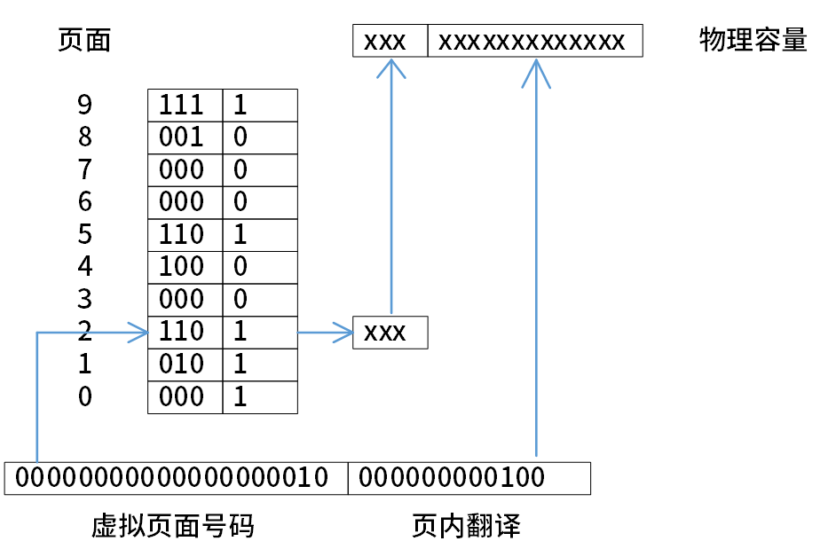
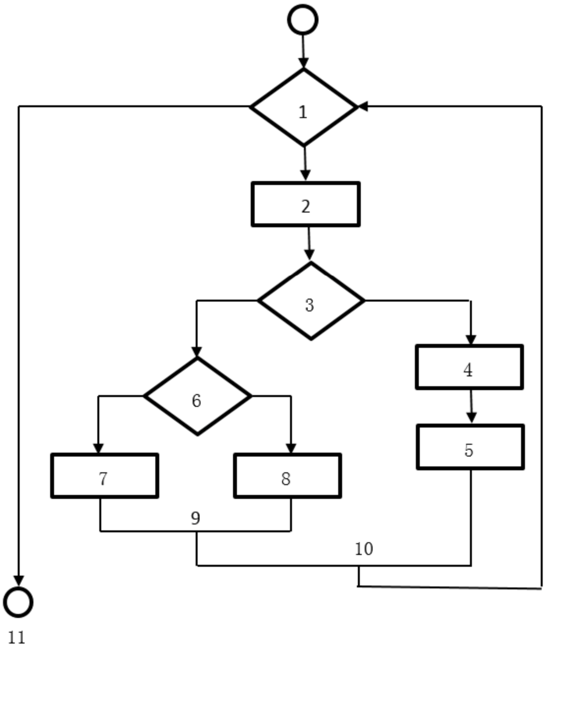

:author: https://github.com/wangzhaohe/swot-learning
:source-highlighter: pygments
:icons: font
:font-size: 16px
:scripts: cjk
:stem: latexmath
:experimental:
:toc:
:toc: right
:toc-title: 目录
:toclevels: 3
:tip-caption: ⚡
:note-caption: ❕
:important-caption: ❗
:caution-caption: ⚠️
:warning-caption: ‼️

= 选择题

// 只有当后端不是 pdf 时才包含以下内容
ifndef::backend-pdf[]
++++

<button id="toggleButton">展开目录</button>

    

++++
endif::[]

== 计算机基础

=== 分页内存管理
分页内存管理的核心是将虚拟内存空间和物理内存空间皆划分为大小相同的页面，并以页面作为内存空间的最小分配单位。下图给出了内存管理单元的虚拟地址到物理地址的翻译过程，假设页面大小为4KB，那么CPU发出虚拟地址0010000000000100后，其访问的物理地址是（A）。

    A 0110000000000100
    B 0100000000000100
    C 1100000000000000
    D 1100000000000010

==== 答案解析
页面大小为 4KB = stem:[2^{12}]B，所以页内偏移占低 12 位。

虚拟地址：

[stem]
++++
0010\ 0000\ 0000\ 0100
++++

* 虚拟页号 = 高 4 位：stem:[0010_2=2]
* 页内偏移 = 低 12 位：stem:[000000000100_2=4]

查页表，页号 2 对应的物理页框号为：

[stem]
++++
110_2=6
++++

物理地址 = 物理页框号拼接页内偏移：

[stem]
++++
110\ 000000000100_2 = 110000000000100_2
++++

即十六进制：

[stem]
++++
0x6004
++++

因此，访问的物理地址是 *0x6004*（或写成二进制 *0110 0000 0000 0100*）。

==== 追加问题
追问：图片中页表最后一列单个数字列表示什么？

图片中页表最后一列的单个数字（0 或 1）表示的是**存在位（Present Bit）**，也叫**有效位（Valid Bit）**。

它的含义是：

* *1*：表示该页面当前*已经调入物理内存*，页表中对应的物理页框号是有效的，可以正常进行地址转换。
* *0*：表示该页面当前*不在物理内存中*（可能还在磁盘上，或者尚未分配），此时如果访问该页面，会触发*缺页中断（Page Fault）*，由操作系统负责将页面从外存调入内存。

结合图片来看：

* 页号 0、1、2、5、9 对应的存在位为 1，说明这些页面在内存中；
* 页号 3、4、6、7、8 对应的存在位为 0，说明这些页面不在内存中。

题目中访问的虚拟页号是 *2*，查表发现页号 2 的存在位为 *1*，物理页框号为 *110*（即 6），因此可以顺利完成地址转换，得到物理地址 0x6004。如果访问的是页号 3，则会因为存在位为 0 而触发缺页中断。

== 软件工程 

=== 环形复杂度
使用 McCabe 方法可以计算程序流程图的环形复杂度，下图的环形复杂度为（4 ）。

    A 3 
    B 4 
    C 5 
    D 6

---

解答：图 G 的环形复杂度 V(G)=P+1， 其中，P 是流图中判定结点的数目。

判定结点：1、3、6。

本题中，P=3，所以V（G）=3+1=4。

=== CMMI
CMMI 中，组织使用从多个项目收集来的数据对整体的组织级绩效进行关注属于（D）级别。

A 已管理 B 已定义 C 量化管理 D 优化

---

*能力成熟度模型集成 CMMI*

主要用于指导软件开发过程的改进和进行软件开发能力的评估。CMMI 提供了一个软件能力成熟度的框架，它将软件过程改进的步骤组织成 *5个成熟度等级*，共包括 *18个关键过程域*，*52个过程目标*，*3168种关键实践*（注：原文图片中为“关键时间”，结合软考知识语境应为“关键实践”），它为软件过程不断改进奠定了一个循序渐进的基础。五个成熟度级别如下：

[width="100%",cols="<15%,<85%",options="header",]
|===
|能力等级 |特点
|*初始级* |过程通常是**随意且混乱**的。这些组织的成功依赖于组织内人员的能力与英雄主义。
|*已管理级* |组织要**确保策划、文档化、执行、监督和控制项目级的过程**，并且需要为过程建立明确的目标，并能实现成本、进度和质量目标等。
|*已定义级* |企业能够**根据自身的特殊情况定义适合自己企业和项目的标准流程**，将这套管理体系与流程予以制度化，同时企业开始进行项目积累，企业资产的收集。
|*量化管理级* |组织建立了**产品质量、服务质量以及过程性能的定量目标**。成熟度级别3级与4级的关键区别在于**对过程性能的可预测**。
|*优化级* |企业的项目管理达到了**最高的境界**。
          成熟度级别5级关注于通过增量式的与创新式的过程与技术改进，不断地改进过程性能。
          处于成熟度5级时，组织使用从多个项目收集来的数据对整体的组织级绩效进行关注。
|===

=== 设计模式
设计模式基于面向对象技术，是人们在长期的开发实践中良好经验的结晶，提供了一个简单、统一的描述方法，使得人们可以复用这些软件设计办法、过程管理经验。 +
按照设计模式的目的进行划分，现有的设计模式可以分为创建型、（1）和行为型三种类型。 +
其中（2）属于创建型模式，（3）属于行为型模式。 +
（4 ）模式可以将一个复杂的组件分成功能性抽象和内部实现两个独立的但又相关的继承层次结构，从而可以实现接口与实现分离。

[cols="1,1,1,1",options="header"]
|===
|1 |2 |3 |4
|A 合成型
|B 组合型
|#C 结构型#
|D 聚合型

|A Adaptor
|B Facade
|C Command
|#D Singleton#

|A Decorator
|B Composite
|#C Memento#
|D Builder

|A Prototype
|B Flyweight
|C Adapter
|#D Bridge#
|===

==== 答案解析
这道题考查的是设计模式的分类和特点。我们逐空分析：

'''''

*（1）结构型*

设计模式按目的分为三大类：

* *创建型*（Creational）：关注对象的创建
* *结构型*（Structural）：关注类和对象的组合
* *行为型*（Behavioral）：关注对象之间的交互和职责分配

所以（1）填 *结构型*，对应选项 *C*。

'''''

*（2）Singleton（单例模式）*

创建型模式包括：Singleton（单例）、Factory Method（工厂方法）、Abstract Factory（抽象工厂）、Builder（建造者）、Prototype（原型）。

选项中：

* Adaptor（适配器）→ 结构型
* Facade（外观）→ 结构型
* Command（命令）→ 行为型
* *Singleton（单例）→ 创建型* ✔

所以（2）选 *D*。

'''''

*（3）Memento（备忘录模式）*

行为型模式包括：Observer、Strategy、Command、State、Chain of Responsibility、Interpreter、Iterator、Mediator、Memento、Template Method、Visitor 等。

选项中：

* Decorator（装饰器）→ 结构型
* Composite（组合）→ 结构型
* *Memento（备忘录）→ 行为型* ✔
* Builder（建造者）→ 创建型

所以（3）选 *C*。

'''''

*（4）Bridge（桥接模式）*

题干描述："`将一个复杂的组件分成功能性抽象和内部实现两个独立的但又相关的继承层次结构，从而实现接口与实现分离。`"

这正是 *Bridge（桥接）模式* 的定义——将抽象部分与它的实现部分分离，使它们都可以独立地变化。

* *Bridge（桥接）→ 结构型* ✔（正确答案）
* Prototype → 创建型
* Flyweight → 结构型（但用于共享对象，不是接口与实现分离）
* Adapter → 结构型（用于接口转换，不是分离抽象与实现）

所以（4）选 *D*。

'''''

设计模式按**目的**分为三大类：

[width="100%",cols="15%,20%,65%",options="header",]
|===
|类型 |关注点 |包含的模式
|*创建型* |对象的创建 |Singleton、Factory Method、Abstract Factory、Builder、Prototype
|*结构型* |类/对象的组合结构 |Adapter、Bridge、Composite、Decorator、Facade、Flyweight、Proxy
|*行为型* |对象间的交互与职责分配 |Command、Interpreter、Iterator、Mediator、Memento、Observer、State、Strategy、Template Method、Visitor、Chain of Responsibility
|===

=== 架构模式/惯用法/设计模式
（1）的选择是开发一个软件系统时的基本设计决策；
（2）是关注软件系统的设计与实现，描述了如何实现构件及构件之间的关系。
引用一计数是C++管理动态资源时常用的一种（3）。

* (1) #A 架构模式#  B 惯用法   C 设计模式  D 分析模式
* (2) A 架构模式    B 惯用法   #C 设计模式#  D 分析模式
* (3) A 架构模式    #B 惯用法#   C 设计模式  D 分析模式

.三层模式对比总结
[cols=",,,",options="header",]
|===
|模式 |层次 |范围 |例子
|架构模式 |最高层 |系统整体结构 |分层、MVC、微服务
|设计模式 |中间层 |类/对象协作 |工厂、观察者、策略
|惯用法 |最低层 |语言相关技巧 |C++ 引用计数、RAII、PIMPL
|===

== 系统工程与信息系统基础

=== 系统工程之霍尔三维结构
系统工程利用计算机作为工具，对系统的结构、元素、（ ）和反馈等进行分析，以达到最优（ ）、最优设计、最优管理和最优控制的目的。 +
霍尔（A.D. Hall）于1969年提出了系统方法的三维结构体系，通常称为霍尔三维结构，这是系统工程方法论的基础。 +
霍尔三维结构以时间维、（ ）维、知识维组成的立体结构概括性地表示出系统工程的各阶段、各步骤以及所涉及的知识范围。 +
其中时间维是系统的工作进程，对于一个具体的工程项目，可以分为7个阶段，在（ ）阶段会做出研制方案及生产计划。

* A 知识 / B 需求 / C 文档 / *D 信息*
* A 战略 / *B 规划* / C 实现 / D 处理
* A 空间 / B 结构 / C 组织 / *D 逻辑*
* A 规划 / B 拟定 / *C 研制* / D 生产

答案是 D B D C

=== 商业智能系统
商业智能系统的处理过程包括四个主要阶段： +
数据预处理通过（1）实现企业原始数据的初步整合； +
建立数据仓库是后续数据处理的基础； +
数据分析是体现系统智能的关键，主要采用（2）和（3）技术，前者能够实现数据的上卷、下钻和旋转分析，后者利用隐藏的知识，通过建立分析模型预测企业未来发展趋势； +
数据展现主要完成数据处理结果的可视化。

- (1) A 数据映射和关联   B 数据集市和数据立方体  #C 数据抽取、转换和装载#  D 数据清洗和数据集成
- (2) A 知识库   B 数据挖掘  C 联机事务处理    #D 联机分析处理#
- (3) A 知识库   #B 数据挖掘#  C 联机事务处理    D 联机分析处理

---

本题考查商业智能相关概念

BI(商业智能)系统包括数据预处理、建立数据仓库、数据分析和数据展现四个主要阶段。

1. 数据预处理是整合企业原始数据的第一步,它包括数据的抽取（Extraction）、转换（Transformation）和加载（Load）三个过程（ETL 过程）;
2. 建立数据仓库则是处理海量数据的基础;
3. 数据分析是体现系统智能的关键,一般采用 OLAP (联机分析处理)和数据挖掘两大技术。
   * OLAP 不仅进行数据汇总/聚集,同时还提供切片、切块、下钻、上卷和旋转等数据分析功能,用户可以方便地对海量数据进行多维分析。
   * 数据挖掘的目标则是挖掘数据背后隐藏的知识,通过关联分析、聚类和分类等方法建立分析模型,预测企业未来发展趋势和将要面临的问题;
4.在海量数据和分析手段增多的情况下,数据展现则主要保障系统分析结果的可视化.

== 软件架构设计

=== 基于构件的开发模型
基于构件的开发模型包括：软件的需求分析定义、（1）、（2）、（3）以及测试和发布5个顺序执行的阶段。

(1) 
A 构件接口设计
#B 体系结构设计# 
C 元数据设计
D 集成环境设计

(2) 
A 数据库建模
B 业务过程建模
C 对象建模
#D 构件库建立# 

(3) 
#A 应用软件构建# 
B 构件配置管理
C 构件单元测试
D 构件编码实现

---

基于构件的开发模型利用模块化方法将整个系统模块化，并在一定构件模型的支持下复用构件库中的一个或多个软件构件，通过组合手段高效率、高质量地构造应用软件系统的过程。 +
基于构件的开发模型融合了螺旋模型的许多特征，本质上是演化形的，开发过程是迭代的。 +
基于构件的开发模型由软件的需求分析定义、体系结构设计、构件库建立、应用软件构建以及测试和发布 5 个阶段组成。

== 项目管理
在敏捷开发方法中，有固定的开发周期（Sprint），包含三个主要角色，并且每天进行站立会议（Daily Stand-up）的开发框架是（）。

- A 看板（Kanban）
- B 极限编程（Extreme Programming, XP）
- C 精益开发（Lean）
- #D Scrum#

---

本题考察的是敏捷开发方法的分类与核心特征。

敏捷开发（Agile Development）是一种强调迭代、增量、团队协作、快速反馈的软件开发方法。
常见的敏捷框架包括 Scrum、看板（Kanban）、极限编程（XP）、精益（Lean）等。
其中，Scrum 是当前最主流、应用最广泛的敏捷框架之一，这里做个补充，它具有以下显著特征：

1. 固定周期（Sprint）：每次迭代称为一个冲刺周期（Sprint），通常为 1～4 周。每个 Sprint 都应交付一个可用的、可测试的产品增量。

2. 三个角色（Three Roles）： 产品负责人（Product Owner）：负责定义产品目标与需求优先级。 Scrum 主管（Scrum Master）：保证 Scrum 流程顺利执行，移除障碍。 开发团队（Development Team）：跨职能团队，负责实现产品增量。

3. 每日站会（Daily Scrum）：每天进行约 15 分钟的站立会议，讨论： 昨天做了什么？今天准备做什么？是否遇到阻碍？

4. 其他关键活动： Sprint 计划会（Sprint Planning）、 Sprint 评审会（Sprint Review）、Sprint 回顾会（Sprint Retrospective）

- A 选项 看板（Kanban）：没有固定迭代周期，以持续流（Continuous Flow）方式工作。
- B 选项 极限编程（XP）：强调工程实践，如结对编程、持续集成、测试驱动开发等，但没有固定角色划分与每日站会要求。
- C 选项 精益开发（Lean）：关注减少浪费与流程优化，不强调固定周期或角色划分。
- D 选项 Scrum：符合题干描述——固定周期、三角色、每日站会。

因此，正确答案为 D（Scrum）

== 英语选择

=== Multi-agent systems
Multi-agent systems can operate under various （1）.

In centralized networks, a central unit contains the global knowledge base, connects the agents and oversees their information. 

A strength of this structure is the ease of communication between agents and （2） knowledge. 

A weakness of the centrality is the dependence on the central unit; if it fails, the（3） system of agents fails. 

Agents in decentralized networks share information with their（4）agents instead of a global knowledge base. Some benefits of decentralized networks are robustness and modularity. 

The failure of one agent does not cause the overall system to fail since there is no central unit. 

One challenge of decentralized agents is（5）their behavior to benefit other cooperating agents.

[cols="1,1,1,1,1",options="header"]
|===
|1                  |2          |3              |4                |5
|A structures       |A local    |A diverse      |A adjacent       |A organizing
|#B architectures#  |#B Global# |B specialized  |#B neighboring#  |#B coordinating#
|C frameworks       |C shared   |#C uniform#    |C connected      |C managing
|D designs          |D central  |D common       |D surrounding    |D controlling
|===

[width="100%",cols="10%,20%,70%",options="header",]
|===
|空 |答案 |解析
|（1） |*B architectures* |多智能体系统可以运行在不同**架构**下。后文 centralized networks / decentralized networks 正是系统架构类型。`architectures` 最专业、最搭配 `operate under`。
|（2） |*B Global* |集中式网络中有一个 central unit，包含 *global knowledge base*。因此优点是智能体之间以及与**全局知识**的通信较容易。与后文 `global knowledge base` 对应。
|（3） |*C uniform* |集中式的弱点是依赖中心单元；如果中心单元失效，则整个**统一的**智能体系统失效。`uniform` 表示统一、整体一致的系统。
|（4） |*B neighboring* |去中心化网络中，智能体与**邻近的**智能体交换信息，而不是依赖全局知识库。固定搭配是 `neighboring agents`。
|（5） |*B coordinating* |去中心化智能体的一个挑战是**协调**它们的行为，使其他合作智能体受益。`coordinate behavior` 是常见搭配。
|===

