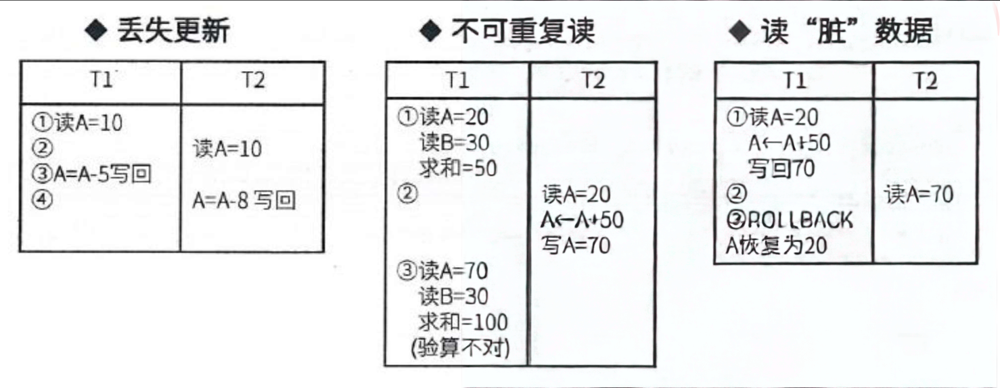

:author: https://github.com/wangzhaohe/swot-learning
:source-highlighter: pygments
:icons: font
:font-size: 16px
:scripts: cjk
:stem: latexmath
:experimental:
:toc:
:toc: right
:toc-title: 目录
:toclevels: 3
:tip-caption: ⚡
:note-caption: ❕
:important-caption: ❗
:caution-caption: ⚠️
:warning-caption: ‼️

= 软考系统架构设计师--考试用

// 只有当后端不是 pdf 时才包含以下内容
ifndef::backend-pdf[]
++++
<style>
/* 1. 默认状态：初始就是隐藏的 */
#toc {
    max-width: 0 !important;
    opacity: 0 !important;
    padding-left: 0 !important;
    padding-right: 0 !important;
    border: none !important;
    overflow: hidden !important; /* 必须在这里，保证收缩时内容不溢出 */
    white-space: nowrap !important;

    /* 【关键】：过渡动画必须放在基类里，这样“展开”和“收回”都有动画 */
    transition: max-width 0.3s cubic-bezier(0.4, 0, 0.2, 1),
                padding 0.3s cubic-bezier(0.4, 0, 0.2, 1),
                opacity 0.3s ease;
}

/* 2. 展开状态：点击后添加 .active 或 .expanded 类 */
#toc.active {
    max-width: 530px !important;
    opacity: 1 !important;
    padding: 10px !important; /* 根据需要恢复 padding */
    overflow-y: auto !important;
}

/* 3. 列表样式保持不变 */
#toc ul, #toc li {
    margin-bottom: 8px !important;
    line-height: 1.4 !important;
}
</style>

<button id="toggleButton">展开目录</button>
<div id="toc">
    </div>

<script>
const toggleButton = document.getElementById('toggleButton');
const contentDiv = document.getElementById('toc');

toggleButton.addEventListener('click', () => {
    // 切换 active 类
    const isExpanded = contentDiv.classList.toggle('active');

    // 逻辑：如果现在是 expanded (true)，说明打开了，按钮应该提示“收起”
    toggleButton.textContent = isExpanded ? '收起目录' : '展开目录';
});
</script>
++++
endif::[]

== 数据库


=== 事务管理
事务提交是 commit，事务回滚是 rollback。

事务: 由一系列操作组成，这些操作，要么全做，要么全不做，拥有四种特性，详解如下:

* (操作)原子性: 要么全做，要么全不做。
* (数据)一致性: 事务发生后数据是一致的，例如银行转账，不会存在A账户转出，但是B账户没收到的情况。
* (执行)隔离性: 任一事务的更新操作直到其成功提交的整个过程对其他事务都是不可见的，不同事务之间是隔离的，互不干涉。
* (改变)持续性: 事务操作的结果是持续性的。即事务一旦提交，结果永久有效，系统故障也不丢失。

事务是并发控制的前提条件，并发控制就是控制不同的事务并发执行，提高系统效率，但是并发控制中存在下面三个问题:

* 丢失更新: 事务 1 对数据 A 进行了修改并写回，事务 2 也对 A 进行了修改并写回，此时事务 2 写回的数据会覆盖事务 1 写回的数据，就丢失了事务 1 对 A 的更新。即对数据 A 的更新会被覆盖。
* 不可重复读: 事务 1 读 A，而后事务 2 对数据 A 进行了修改并写回，此时若事务 1 再读 A，发现数据不对。即一个事务重复读 A 两次，会发现数据 A 有误。
* 读脏数据: 事务 1 对数据 A 进行了修改后，事务 2 读数据 A，而后事务 1 回滚，数据 A 恢复了原来的值，那么事务 2 对再对数据 A 做什么就不对了，因为 事务 2 读到的是脏数据。



==== 并发控制基本概念图
[mermaid, target=img/mermaid-并发控制基本概念图, format=png]
....
flowchart TD
    %% Define styles to match the image colors
    classDef greenBox fill:#bdf0c5,stroke:#5ea864,stroke-width:2px,rx:5,ry:5;
    classDef blueBox fill:#bde0f0,stroke:#5ea8d6,stroke-width:1px;
    %% classDef circleStyle fill:#cdf5cd,stroke:#5ea864,stroke-width:2px,shape:circle;
    classDef pillStyle fill:#cdf5cd,stroke:#5ea864,stroke-width:2px,shape:circle;

    %% Left Side: 事务 (Transaction)
    %% Transaction(("事务")):::circleStyle
    Transaction(["事务"]):::pillStyle
    ACID["✓ 原子性<br>✓ 一致性<br>✓ 隔离性<br>✓ 持续性"]:::blueBox

    Transaction --> ACID

    %% Center Flow: Problems -> Solutions -> Deadlock
    ConcurrencyIssues["并发产生的问题"]:::greenBox
    LockingProtocol["封锁协议"]:::greenBox
    DeadlockProblem["死锁问题"]:::greenBox

    ConcurrencyIssues -- "解决方案" --> LockingProtocol
    LockingProtocol --> DeadlockProblem

    %% Right Side: Details for Concurrency Issues
    IssuesDetail["✓ 丢失更新<br>✓ 不可重复读问题<br>✓ “脏”数据的读出"]:::blueBox
    ConcurrencyIssues --> IssuesDetail

    %% Right Side: Details for Locking Protocol
    LockTypes["✓ S封锁<br>✓ X封锁"]:::blueBox
    ProtocolLevels["✓ 一级封锁协议<br>✓ 二级封锁协议<br>✓ 三级封锁协议<br>✓ 两段锁协议"]:::blueBox

    LockingProtocol --> LockTypes
    LockingProtocol --> ProtocolLevels

    %% Right Side: Details for Deadlock
    DeadlockSolutions["✓ 预防法<br>✓ 死锁的解除法"]:::blueBox
    DeadlockProblem --> DeadlockSolutions

    %% Layout adjustments to mimic the image structure
    %% (Invisible links to help position nodes)
    ACID ~~~ ConcurrencyIssues
    IssuesDetail ~~~ LockTypes
....

==== 封锁协议
x 锁是排它锁(写锁)：若事务 T 对数据对象 A 加上 X 锁，则只允许 T 读取和修改 A，其他事务都不能再对 A 加任何类型的锁，直到 T 释放 A 上的锁。

S 锁是共享锁(读锁)：若事务 T 对数据对象 A 加上 S 锁，则只允许 T 读取 A，但不能修改 A。其他事务只能再对 A 加 S 锁(即能读不能修改)，直到 T 释放 A 上的 S 锁。

共有三级封锁协议，定义如下:

* 一级封锁协议: 事务在修改数据 R 之前必须先对其加 X 锁，直到事务结束才释放。
    ** 可解决丢失更新问题。

* 二级封锁协议: 一级封锁协议的基础上加上事务 T 在读数据 R 之前必须先对其加 S 锁，读完后即可释放 S 锁。
    ** 可解决丢失更新、读脏数据问题。

* 三级封锁协议: 一级封锁协议加上事务 T 在读取数据 R 之前先对其加 S 锁，直到事务结束才释放。
    ** 可解决丢失更新、读脏数据、数据重复读问题。

==== 封锁协议通俗诠释
可以把“数据”想成一本**公共账本**，事务就是来账本上办事的人。

===== 1. 两种锁用生活话理解
* *X 锁（排它锁/写锁）＝“我要改，门锁上”* +
谁拿了 X 锁，谁就能读和改；别人**什么锁都不能加**，只能等。相当于“我正在改，谁都别碰”。

* *S 锁（共享锁/读锁）＝“我只看看，贴个阅览牌”* +
谁拿了 S 锁，谁只能读不能改；别人还能继续加 S 锁一起读，但**不能加 X 锁改**。相当于“大家可以一起看，但谁也别改”。

一句话：*X 锁排斥所有人；S 锁只排斥想改的人。*

===== 2. 三级封锁协议，用“改账本/看账本”解释
[discrete]
===== 一级封锁协议：改之前先独占，改完到事务结束才还钥匙

规则： +
*事务要修改数据 R，必须先加 X 锁，而且一直持有到事务结束（提交或回滚）才释放。*

生活比喻： +
你要改账本，先把账本锁进柜子，钥匙拿到自己手里；*改完不算完，要等整个事情办完（提交/回滚）才还钥匙*。

解决：*丢失更新*。 +
例子：余额 100，T1 想改成 110，T2 想改成 120。 +
如果没有锁，两人都读到 100，最后可能一个修改把另一个覆盖掉。 +
一级协议下，T1 改之前拿 X 锁，T2 想改只能等，不会同时改。

____
一级协议只管“写”，不管“读”。所以它防不住脏读。
____

[discrete]
===== 二级封锁协议：一级 + 读之前先领“阅览牌”，读完马上还

规则： +
在一级基础上，*事务读 R 之前必须先加 S 锁，读完立刻释放 S 锁*。 +
注意：写操作仍然要 X 锁并持有到事务结束。

生活比喻： +
你要看账本，先领“共享阅览牌”；如果有人在改账本（拿着 X 锁），你领不到牌，只能等。你**看完马上还牌**。

解决：*丢失更新 + 读脏数据*。

脏读就是：别人改了数据但还没提交，甚至可能回滚，你却读到了。 +
二级协议下，别人改数据时拿着 X 锁，你读之前要 S 锁，但 S 和 X 不能共存，所以你只能等，*读不到别人没提交的中间值*。

____
二级协议读完就还 S 锁，所以防不住“不可重复读”。
____


[discrete]
===== 三级封锁协议：一级 + 读之前领牌，而且一直拿到事务结束

规则： +
在一级基础上，*事务读 R 之前先加 S 锁，并且一直持有到事务结束才释放*。

生活比喻： +
你要看账本，先领“共享阅览牌”，而且**看了一次不还牌，直到你整个事情办完才还**。这样期间别人想改账本也改不了。

解决：*丢失更新 + 读脏数据 + 不可重复读*。

不可重复读就是： +
T1 第一次读余额是 100；T2 改成 90 并提交；T1 再读变成 90，两次读不一样。 +
三级协议下，T1 第一次读时拿 S 锁并一直拿到结束，T2 想改就要 X 锁，但 X 和 S 不能共存，所以 T2 改不了。T1 两次读都还是 100。

===== 3. 一张表总结
[width="100%",cols="25%,25%,25%,25%",options="header",]
|===
|协议 |写怎么锁 |读怎么锁 |能解决
|一级 |改前加 X 锁，直到事务结束 |不管读 |丢失更新
|二级 |同一级 |读前加 S 锁，读完马上放 |丢失更新、脏读
|三级 |同一级 |读前加 S 锁，直到事务结束才放 |丢失更新、脏读、不可重复读
|===

最容易记的口诀

* *一级：写要独占到底。*
* *二级：一级 + 读时加共享锁，读完就放。*
* *三级：一级 + 读时加共享锁，读到事务结束才放。*

再短一点：
*一级防“两人同时改”；二级再防“读到别人没提交的脏数据”；三级再防“我读两次之间别人插进来改”。*

==== 两段锁协议
每个事务的执行可以分为两个阶段: 生长阶段(加锁阶段)和衰退阶段(解锁阶段)

* 加锁阶段: 在该阶段可以进行加锁操作。
  在对任何数据进行读操作之前要申请并获得 S 锁，在进行写操作之前要申请并获得 x 锁。
  加锁不成功，则事务进入等待状态，直到加锁成功才继续执行。

* 解锁阶段: 当事务释放了一个封锁以后，事务进入解锁阶段，在该阶段只能进行解锁操作不能再进行加锁操作。

两段封锁法可以这样来实现: 
事务开始后就处于加锁阶段，一直到执行 ROLLBACK 和 COMMIT 之前都是加锁阶段。
ROLLBACK 和 COMMIT 使事务进入解锁阶段，即在 ROLLBACK 和 COMMIT 模块中 DBMS 释放所有封锁。

---

#### 上面文字说了三件事

1. **事务开始后，只加锁，不解锁。** 读之前加 S 锁，写之前加 X 锁，加不到就等着。
2. **一旦释放了第一个锁，就进入解锁阶段，之后只能解锁，不能再加锁。**
3. **实现上，事务开始到 COMMIT/ROLLBACK 之前都算加锁阶段；COMMIT/ROLLBACK 时一次性释放所有锁。**

#### 画成一条线

```
事务开始 ———————————————— COMMIT/ROLLBACK ———— 结束
        [      加锁阶段：只能加锁      ] [解锁阶段：释放所有锁]
```

分界线就是**第一次解锁**。在此之前只能加锁，在此之后只能解锁。

#### 为什么这么规定

防止一个事务“先解锁、再回头加锁”，那样并发执行会乱，结果不可串行化。仅此而已。

#### 一句话

**加锁要一口气加完，然后才能开始解锁；解锁后不许再加锁。**

== 软件架构风格
软件体系结构设计的一个核心目标是重复的体系结构模式，即 ##达到体系结构级的软件重用##。
也就是说，在不同的软件系统中，使用同一体系结构。
基于这个目标，主要任务是研究和实践软件体系结构风格和类型问题。

软件体系结构风格是描述某一特定应用领域中系统组织方式的惯用模式。 
架构风格定义一个系统家族，即一个架构定义一个词汇表和一组约束。
词汇表中包含一些构件和连接件类型，而这组约束指出系统是如何将这些构件和连接件组合起来的。

架构风格反映了领域中众多系统所共有的结构和语义特性，并指导如何将各个模块和子系统有效地组织成一个完整的系统。
对软件架构风格的研究和实践促进对设计的重用，一些经过实践证实的解决方案也可以可靠地用于解决新的问题。

'''

这段文字是典型的”学术黑话”，把本来挺简单的道理包装得云山雾罩。用大白话翻译一遍：

=== 逐句翻译

*原文：* 软件体系结构设计的一个核心目标是重复的体系结构模式，即达到体系结构级的软件重用。

*人话：* 设计软件架构时，最想干的一件事就是——*别每次都从头造轮子，能抄就抄（抄自己以前的设计）。*

*原文：* 在不同的软件系统中，使用同一体系结构。

*人话：* 就是说，做 A 系统和做 B 系统，可以用同一套”骨架”。

*原文：* 基于这个目标，主要任务是研究和实践软件体系结构风格和类型问题。

*人话：* 所以大家就去研究：到底有哪些常见的”骨架套路”可以用？

*原文：* 软件体系结构风格是描述某一特定应用领域中系统组织方式的惯用模式。

*人话：* 所谓”架构风格”，就是**某个领域里大家约定俗成的搭积木方式。**

*原文：* 架构风格定义一个系统家族，即一个架构定义一个词汇表和一组约束。词汇表中包含一些构件和连接件类型，而这组约束指出系统是如何将这些构件和连接件组合起来的。

*人话：* 一种架构风格规定了：

    - *能用哪些积木*（构件，比如”模块”"`服务`""`过滤器`"） 
    - *积木之间怎么插*（连接件，比如”调用”"`管道`""`消息`"） 
    - *插的时候有什么规矩*（约束，比如”必须分层，不能跨层调用”）

*原文：* 架构风格反映了领域中众多系统所共有的结构和语义特性，并指导如何将各个模块和子系统有效地组织成一个完整的系统。

*人话：* 架构风格就是从一堆同类系统里总结出来的**通用套路**，告诉你这些模块该怎么拼才靠谱。

*原文：* 对软件架构风格的研究和实践促进对设计的重用，一些经过实践证实的解决方案也可以可靠地用于解决新的问题。

*人话：* 研究这些套路的好处是：*别人踩过的坑你不用再踩，验证过的方案直接拿来用。*

'''''

=== 一句话总结

____
*架构风格 = 搭软件的常用套路。研究它，就是为了能复用、少走弯路。*
____

=== 为什么这段话”不说人话”

学术写作有几个坏毛病，这段全占了：

[width="100%",cols="30%,70%",options="header",]
|===
|毛病 |例子
|*名词化* |"`达到体系结构级的软件重用`" ← 其实就是”复用架构”
|*循环定义* |"`架构风格定义一个系统家族，即一个架构定义……`" 用”架构”解释”架构”
|*抽象叠抽象* |"`词汇表`""`约束`""`构件`""`连接件`"——四个术语套在一起，其实就是在说”零件和拼法”
|*正确的废话* |"`促进对设计的重用`"——谁不想重用呢？关键是怎么重用，它没说
|===

所以你读着累，不是你的问题，是写的人**把简单的事说复杂了**。
考试/论文里这么写是为了显得”严谨”，但日常理解，记住我上面那句大白话就够了。

=== 1. 数据流风格
面向数据流，按照一定的顺序从前向后执行程序，代表的风格有：

* 批处理序列
* 管道-过滤器

==== 专业描述
批处理风格：

* 每个处理步骤是一个单独的程序，每一步必须在前一步结束后才能开始，并且数据必须是完整的，以整体的方式传递。
* 它的基本构件是独立的应用程序，连接件是某种类型的媒介。
* 连接件定义了相应的数据流图，表达拓扑结构。

管道-过滤器：

* 把系统分解为几个序贯的处理步骤，这些步骤之间通过数据流连接，一个步骤的输出是另一个步骤的输入。
* 每个处理步骤由一个过滤器(Filter)实现，处理步骤之间的数据传输由管道(Pipe)负责。
* 基本构件是过滤器，连接件是数据流传输管道，将一个过滤器的输出传到另一过滤器的输入。

==== 通俗解释
*本质区别就一句话：谁在指挥？*

*批处理*：有个”老板”在指挥。 

- 老板说：第一步，读文件；第二步，算总数；第三步，写结果。 
- 每个步骤干完都得向老板汇报，老板再喊下一步。 
- 步骤之间是**上下级关系**，老板不喊，下一步不动。

*管道*：没有老板，每个人自己管自己。 

- 第一个人只管从源头拿数据，拿到就往后扔。 
- 第二个人只管等着，前面扔过来一个就处理一个，再往后扔。 
- 没人指挥，*数据来了就干活，没来就等着*。 
- 每个人甚至不知道后面是谁。

*打个比方*

* 批处理 = *做饭*：你先把菜全切好，再全部下锅，再全部装盘。你是那个老板，每一步你都得盯着。
* 管道 = *传菜*：洗菜的人洗好一盘就往下一递，切菜的人接到就切，切完再往下递。没人喊”开始”，菜到了就干。

==== Example
*判断你该用哪个*

* *数据要攒齐才有意义*（比如”算昨天总销售额”）→ 批处理。
* *数据来一条就能算一条*（比如”实时风控、实时推荐”）→ 管道。

*一句话* 

- 批处理：*等齐了再开干，一个老板统管全程。* 
- 管道：*来一个干一个，各干各的靠数据接力。*

===== 日志处理系统
*批处理做法（老板喊口令）* 

- 凌晨2点，定时任务启动。 
- 第一步：把昨天的日志文件全部读进内存。 
- 第二步：全部过滤出error。 
- 第三步：全部统计计数。 
- 第四步：写入报表。 - *特点*：必须等日志文件攒够一天，才能开始。中间任何一步卡住，全停。

*管道做法（传菜）* 

- Filebeat 盯着日志文件，来一行就抓一行，扔给下一环。 
- Logstash 接到一行就解析一行，扔给下一环。 
- Elasticsearch 接到就索引一条。 
- *特点*：日志一产生就处理，各环节同时跑，谁也不用等谁。

===== 电商订单
*批处理做法* 

- 每晚跑一次：把所有当天订单读出来 → 算总价 → 扣库存 → 发邮件。 
- 用户下午下的单，晚上才处理。

*管道做法* 

- 用户一点”下单”，消息立刻进 Kafka。 
- 库存服务、支付服务、通知服务各自订阅，**同时**收到消息各自处理。 
- 用户几秒内就收到确认。

===== 视频转码
*批处理* 

- 上传完整个视频 → 等转码服务器空闲 → 整个文件转完 → 再上传CDN。 
- 用户得等全片转完才能看。

*管道* 

- 视频一边上传，转码器一边分片转码，转好一片就推给CDN一片。 
- 用户几乎能边传边看（直播就是这个思路）。

===== Linux 命令
*批处理写法*

[source,bash]
----
# 老板喊口令：先全读，再全过滤，再全排序
cat access.log > tmp1
grep "404" tmp1 > tmp2
sort tmp2 > tmp3
uniq -c tmp3
----

每步等上一步**全部**做完，还要落盘临时文件。

*管道写法*

[source,bash]
----
cat access.log | grep "404" | sort | uniq -c
----

四个进程**同时**跑，数据像传菜一样一条条流过，不落临时文件。

===== 大数据里的对应
* *批处理* = Hadoop MapReduce、Spark 批任务。攒一批数据，跑一轮，出一批结果。

* *管道* = Kafka + Flink/Storm 流处理。数据一条条来，一条条算，实时出结果。

=== 2. 调用/返回风格
构件之间存在互相调用的关系，一般是显式的调用，代表的风格有：

* 主程序/子程序
* 面向对象
* 层次结构
* 客户端/服务器风格

==== 主程序/子程序
* 单线程控制，把问题划分为若干个处理步骤。
* 构件即为主程序和子程序，子程序通常可合成为模块。
* 过程调用作为交互机制，充当**连接件**的角色。

==== 面向对象
* 构件是对象，对象是抽象数据类型的实例。
* 连接件即使对象间交互的方式，对象是通过函数和过程的调用来交互的。

==== 层次结构
* 构件组成一个层次结构，连接件通过决定层间如何交互的协议来定义。
* 每层为上一层提供服务，使用下一层的服务，只能见到与自己邻接的层。
* 修改某一层，最多影响其相邻的两层（通常只能影响上层）。

==== 客户端/服务器架构风格
* 两层C/S 体系结构主要组成部分：数据库服务器、客户应用程序。称为“胖客户机，瘦服务器”。

NOTE: 现在不用两层体系结构了

* 三层C/S 结构：
** 增加了一个应用服务器。
** 整个应用逻辑驻留在应用服务器上，只有表示层存在于客户机上，故称为“瘦客户机”。
** 应用功能分为表示层、功能层和数据层三层。

=== 3. 独立构件风格
构件之间是互相独立的，不存在显式的调用关系，而是通过某个事件触发、异步的方式来执行，代表的风格有：

* 进程通信
* 事件驱动系统（隐式调用）

---

[upperalpha]
. 进程通信风格

* *核心概念*：
    ** *构件*：独立的过程（通常是命名过程）。
    ** *连接件*：消息传递。
* *通信方式*：
    ** 支持点到点通信。
    ** 支持同步或异步方式。
    ** 支持远程过程调用 (RPC)。


. 事件驱动系统（隐式调用）

* *核心思想*：
    ** 构件**不直接调用**过程，而是**触发或广播事件**。
    ** 其他构件中的过程需先在事件中**注册**。
    ** 当事件被触发时，系统自动调用所有注册过的过程。
* *架构组成*：
    ** *构件*：既可以是模块（过程），也可以是事件的集合。
    ** *调用方式*：既支持通用方式调用，也支持在系统事件中注册调用。
* 例子：发布-订阅模式（Pub/Sub）

* 总结：优缺点分析
** 主要优点
*** 强大的复用支持：为软件复用提供了强有力的基础。 
*** 易于维护与演化：方便构件的维护和后续演化。

** 主要缺点
*** 失去控制权：构件放弃了对自己系统计算过程的控制权（因为是被动触发）。

*一句话总结：* 
这一页主要讲的是**独立构件风格**，重点区分了**进程通信**（直接消息传递）和**事件驱动**（隐式调用/注册触发）两种模式，并指出了事件驱动模式虽然利于复用和维护，但牺牲了对计算流程的直接控制。

==== 发布-订阅模式（Pub/Sub）例子
[mermaid, target=img/mermaid-pub-sub, format=svg]
....
flowchart TD
    subgraph SUB[subscribe 被调用 3 次 — 每次生成一套独立闭包]
        direction TB
        Call1["subscribe('📱手机端', fn1)"] --> S1["本次作用域:<br/>el1 = div①<br/>name='📱手机端'<br/>format=fn1"]
        Call2["subscribe('💻桌面端', fn2)"] --> S2["本次作用域:<br/>el2 = div②<br/>name='💻桌面端'<br/>format=fn2"]
        Call3["subscribe('🤖量化', fn3)"] --> S3["本次作用域:<br/>el3 = div③<br/>name='🤖量化'<br/>format=fn3"]
        S1 --> CbA["cbA = (data) =&gt; { el1.textContent = ... }<br/>← 闭包捕获 el1,name,format"]
        S2 --> CbB["cbB = (data) =&gt; { el2.textContent = ... }<br/>← 闭包捕获 el2,name,format"]
        S3 --> CbC["cbC = (data) =&gt; { el3.textContent = ... }<br/>← 闭包捕获 el3,name,format"]
    end

    CbA --> Store["bus.on('priceUpdate', cb)<br/>→ Set[cbA, cbB, cbC]"]
    CbB --> Store
    CbC --> Store

    Store -. "函数本体+闭包留在 Map 里" .-> Emit

    subgraph PUB[发布阶段 — emit 取出来逐个调用]
        Emit["emit('priceUpdate','股票上涨5%')<br/>set = 取回 Set[cbA,cbB,cbC]"]
        Emit --> ForEach["[...set].forEach(cb =&gt; cb('股票上涨5%'))"]
        ForEach --> RunA["cbA('股票上涨5%')<br/>→ 用捕获的 el1 改 div①"]
        ForEach --> RunB["cbB('股票上涨5%')<br/>→ 用捕获的 el2 改 div②"]
        ForEach --> RunC["cbC('股票上涨5%')<br/>→ 用捕获的 el3 改 div③"]
    end
....

.例子代码：#file static_example_code/event-pub-sub.html
[source,html]
----
<!DOCTYPE html>
<html lang="zh-CN">
    <head>
        <meta charset="UTF-8" />
        <meta name="viewport" content="width=device-width, initial-scale=1.0" />
        <title>发布-订阅模式演示</title>
        <style>
            body {
                font-family: system-ui, sans-serif;
                max-width: 560px;
                margin: 2rem auto;
                padding: 0 1rem;
                color: #1e293b;
            }
            input, button {
                font: inherit;
                padding: 0.5rem 0.9rem;
                border-radius: 8px;
                border: 1px solid #cbd5e1;
            }
            button {
                background: #3b82f6;
                color: #fff;
                border: none;
                cursor: pointer;
            }
            .subscriber {
                padding: 0.6rem 1rem;
                margin: 0.5rem 0;
                background: #f1f5f9;
                border-radius: 8px;
            }
        </style>
    </head>
    <body>
        <h1>📡 发布-订阅模式 (Pub/Sub)</h1>
        <p>发布者只管发事件，完全不认识订阅者；事件中心负责把消息广播给所有订阅者。</p>

        <input id="msg" value="股票上涨 5%" />
        <button id="publish">发布事件</button>

        <h2>订阅者</h2>
        <div id="subscribers"></div>
        <script>
            /**
             * 事件中心：发布-订阅（Pub/Sub）模式的实现，只负责三件事：
             * - 登记回调（订阅）：`on(name, cb)`
             * - 删除回调（退订）：`off(name, cb)`
             * - 广播事件（发布）：`emit(name, data)`
             *
             * 内部用 `Map<事件名, Set<回调函数>>` 维护订阅关系，
             * 发布者只调用 `emit` 即可通知所有订阅者，彼此互不感知。
             */
            class EventEmitter {
                constructor() {
                    // { 事件名: Set<回调函数>, ... }
                    this.events = new Map();
                }
                /**
                 * 订阅一个事件，将回调函数登记到对应的事件名集合上。
                 * @param {string} name - 事件名。
                 * @param {(data: any) => void} cb - 事件触发时执行的回调函数，接收事件数据。
                 * @returns {() => void} 退订函数：调用即可移除本次注册的回调。
                 */
                on(name, cb) {
                    if (!this.events.has(name))
                        this.events.set(name, new Set());
                    this.events.get(name).add(cb);
                    return () => this.off(name, cb); // 返回退订函数
                }
                /**
                 * 退订一个事件：从对应事件名集合中移除回调，若集合为空则删除该事件名。
                 * @param {string} name - 事件名。
                 * @param {(data: any) => void} cb - 之前通过 on 注册的回调函数。
                 * @returns {void}
                 */
                off(name, cb) {
                    const set = this.events.get(name);
                    if (set) {
                        set.delete(cb);
                        if (set.size === 0) this.events.delete(name);
                    }
                }
                /**
                 * 发布一个事件：将事件数据广播给所有已订阅该事件的回调函数。
                 * @param {string} name - 事件名。
                 * @param {any} data - 要传递给回调的事件数据。
                 * @returns {void}
                 */
                emit(name, data) {
                    const set = this.events.get(name);
                    // 复制一份，防止遍历中退订出错
                    if (set) [...set].forEach((cb) => cb(data));
                }
            }
            // 每个订阅者：订阅事件 + 只渲染自己这一块
            /**
             * 注册一个订阅者：创建一个 DOM 容器，并订阅指定事件，收到事件后只更新自己的那一块区域。
             * @param {string} name - 订阅者名称，显示在渲染区域前缀（如「📱 手机端」）。
             * @param {(data: any) => string} format - 格式化函数，接收事件数据并返回要显示的字符串。
             * @returns {void}
             */
            function subscribe(name, format) {

                const el = document.createElement("div");
                el.className = "subscriber";
                el.textContent = `${name}：等待事件…`;

                document.getElementById("subscribers").appendChild(el);

                // 订阅事件
                bus.on(EVENT, (data) => {
                    el.textContent = `${name}：${format(data)}`;
                });
            }

            const bus = new EventEmitter();  // 实例化事件中心
            const EVENT = "priceUpdate";     // 事件名

            // 订阅
            subscribe("📱 手机端", (d) => `收到 ${d}`);
            subscribe("💻 桌面端", (d) => `事件 ${d}`);
            subscribe("🤖 量化机器人", (d) => `消息 ${d}`);

            // 发布者：只管发，不认识任何订阅者
            document.getElementById("publish").onclick = () => {
                const data = document.getElementById("msg").value;
                bus.emit(EVENT, data);
            };
        </script>
    </body>
</html>
----

==== waiting -- 发布-订阅模式（Pub/Sub）例子的网络版本改进方案
现在的这个 `event-pub-sub.html` 是一个**纯浏览器内存版、同页面内**的发布-订阅示例。 
一旦让”发布者”和”订阅者”分别跑在**不同的浏览器（甚至只是同一个浏览器的两个标签页）**上，*它们之间完全不会互通*——发布者发出的事件，订阅者一个都收不到。

下面解释为什么，以及要做到”跨网络”需要补什么。

[discrete]
==== 1. 现在的代码到底在做什么

整套机制的核心是一个内存里的对象 `bus`：

[source,javascript]
----
class EventEmitter {
    constructor() {
        this.events = new Map();   // { 事件名: Set<回调函数> }
    }
    on(name, cb) { ... this.events.get(name).add(cb); }
    emit(name, data) {
        const set = this.events.get(name);
        if (set) [...set].forEach((cb) => cb(data));  // 只是循环调用本页面里的函数
    }
}
----

发布按钮也只是调用了同一个 `bus` 实例：

[source,javascript]
----
const bus = new EventEmitter();  // 实例化事件中心
const EVENT = "priceUpdate";

subscribe("📱 手机端", ...);
subscribe("💻 桌面端", ...);
subscribe("🤖 量化机器人", ...);

document.getElementById("publish").onclick = () => {
    const data = document.getElementById("msg").value;
    bus.emit(EVENT, data);   // 只在"这一页"的内存里广播
};
----

关键点：`bus.events` 这个 `Map` 里存的是**当前页面里的函数引用（闭包）**。
`emit` 做的事就是 `forEach` 调用这些本地函数。整个过程**没有一行代码碰到网络**。


[discrete]
==== 2. 跨浏览器时会怎样（为什么不行）

每个浏览器标签页（tab）/每个浏览器进程，都是一个**独立的 JavaScript 运行时 + 独立内存空间**：

* 你在浏览器 A 打开这个文件 → 它自己 `new` 了一个 `busA`，自己 `subscribe` 了三块 div；
* 你在浏览器 B 打开同一个文件 → 它自己 `new` 了一个 `busB`，自己 `subscribe` 了三块 div；
* 浏览器 A 点”发布” → `busA.emit()` → 只触发 `busA` 里的回调 → *只更新浏览器 A 自己的 DOM*；
* 浏览器 B 自始至终**毫无反应**，因为它从来没往 `busA` 里 `on` 过任何回调，也根本拿不到 `busA` 这个对象（`busA` 在另一个进程的内存里，跨进程/跨机器无法共享一个 JS 对象引用）。

`emit` 里遍历的 `Set<回调>` 是内存里的函数对象，*函数没法序列化、没法通过网络传过去*，所以现在的”事件中心”本质上是个*进程内（in-process）的事件中心*，不是网络事件中心。

____
补充：就算你把”不同浏览器”降格成”同一浏览器的两个标签页”，结论也一样——每个标签页是独立的 JS 上下文，各自有各自的 `bus`，依然不通。（同浏览器跨标签页可用 `BroadcastChannel`，但它*仅限于同一浏览器的同源页面*，解决不了”不同浏览器/不同机器”。）
____

[discrete]
==== 3. 要让它真正跨网络，缺什么

缺一个**网络层的”事件中心 / 消息代理（broker）“**——一个所有浏览器都能连上的中间服务器。浏览器之间不能直接互发，必须都连到这个中心，由中心来转发/广播。

[mermaid, target=img/mermaid-pub-sub-network, format=svg]
....
flowchart LR
    subgraph B1[浏览器 A · 发布者]
        P[publish 按钮] -->|WS/HTTP 发送事件| S
    end
    subgraph S[网络事件中心 / 消息代理<br/>（必须新增的服务器）]
        HUB[(event hub: 维护连接列表)]
    end
    subgraph B2[浏览器 B · 订阅者]
        S -->|WS/SSE 推送| SUB1[📱 手机端]
    end
    subgraph B3[浏览器 C · 订阅者]
        S -->|WS/SSE 推送| SUB2[💻 桌面端]
    end
    subgraph B4[浏览器 D · 订阅者]
        S -->|WS/SSE 推送| SUB3[🤖 量化机器人]
    end
....

也就是说，要把”内存里的 `Map`"`换成`"服务器上维护的**客户端连接列表**”，把 `emit` 换成”向所有连接**写socket**”。


[discrete]
==== 4. 几种可选方案对比

[width="100%",cols="28%,45%,27%",options="header",]
|===
|方案 |适合场景 |说明
|*WebSocket + 自建小服务器*（Node `ws` / Python 等） |双向、实时、最通用 |浏览器连上 WS，发布者 `send` 事件，服务器 `broadcast` 给所有订阅者。最贴近你这个示例。
|*SSE（Server-Sent Events）* |服务器→浏览器单向推送 |订阅者用 `EventSource` 接收；发布者用普通 `fetch`/`POST` 把事件发给服务器。实现比 WS 简单。
|*BroadcastChannel* |仅同一浏览器、跨标签页 |零服务器，但**不满足你的”不同浏览器”需求**，这里提一下避免误用。
|*现成消息中间件*（MQTT / Redis Pub-Sub / Kafka / RabbitMQ） |生产级、多服务 |把 `EventEmitter` 换成连这些 broker 的客户端，概念上最”正统”的分布式 Pub/Sub。
|===


[discrete]
==== 5. 建议：做一个”网络版”的最小改造方案

如果你愿意，我可以把这个示例升级成**真正跨浏览器的版本**，思路是：

[arabic]
. 新增一个轻量 WebSocket 服务器（比如 Node 的 `ws`，约 20 行），充当”事件中心”，维护所有连接，`broadcast` 事件；
. 原 `EventEmitter` 不变，但加一个”网络桥”：`emit` 时通过 WS 发给服务器；浏览器收到服务器推送时，再调用本地 `bus.emit` 去更新 DOM；
. 前端 `subscribe` 逻辑基本不动，只是把”事件来源”从本地 `emit` 换成”服务器推送”。

这样你用手机浏览器、桌面浏览器、另一台电脑同时打开，任意一端发布，其余端实时收到——这才是真正的分布式 Pub/Sub。

'''''

要不要我按上面第 5 点给你写一份**具体的改造方案（含服务器代码 + 前端改动）**？如果要，请确认你倾向哪种技术栈：

* *A*：Node.js + `ws`（WebSocket，最贴近原示例，推荐）
* *B*：Node.js + SSE（实现更简单，单向推送）
* *C*：直接用 MQTT / Redis 这类现成 broker（更”生产级”）

确认后我可以给出完整可运行的代码与步骤（注意：当前是 ask 模式，需要你切换到 craft 模式我才能帮你落地文件）。

=== 4. 虚拟机风格
人为构建一个运行环境，在这个环境之上，可以解析与运行自定义的一些语言，这样来增加架构的灵活性。代表的风格有：

* 解释器
* 基于规则的系统

=== 5. 以数据为中心的风格
所有的操作都是围绕建立的数据中心进行的，代表要风格有：

* 仓库风格
* 黑板风格

== 大数据架构


=== Lambda 架构
[cols="1,2,2", options="header"]
|===
| 层 | 特点 | 作用
| Batch Layer（批处理层） | 处理全量历史数据，延迟高但准确 | 生成不可变的、完整的批视图
| Speed Layer（速度层/流处理层） | 只处理最近增量数据，延迟低 | 弥补批处理层的时间差，提供实时视图
| Serving Layer（服务层） | 合并上述两个视图 | 对外提供查询结果
|===

之所以叫 Lambda，是因为它的数据流图形状像希腊字母 λ：

一条线从顶部（数据源）分叉成两条并行路径（批处理 + 流处理）

最后在底部汇合（服务层合并结果）

也就是说，这个名字来自图形形状的类比，λ 的形状恰好描述了“分叉再汇合”的拓扑结构。

==== Lambda 架构大数据演进案例：广告报表写时合并优化
*业务诉求*：在一个广告报表中，同时展示 ##“外部曝光数据”##（第三方如腾讯提供，每天/每小时拉取）和##“内部转化数据”##（用户在平台下单付款，实时产生）。

*技术难点*：两类数据来源不同、时效性不同，如何在报表中完美*合并（Merge）*？

整个架构的演进，就是**“合并（Merge）操作发生的位置”**的演进。

===== 第一版：典型 Lambda 架构（当前痛点：服务层算到崩溃）
*核心逻辑*：底层拼装，把两路数据各自存好，*Java 服务层查询时在内存里做合并（读时合并）*。

[mermaid, target=img/mermaid-广告001, format=svg]
....
graph TD
    subgraph 实时层 [Speed Layer: 实时数据]
        Kafka2[Kafka2 实时下单/付款消息] --> Spark[Spark Streaming] --> Redis[(Redis 实时转化数据)]
    end

    subgraph 服务层 [Serving Layer: 压力山大]
        Java[Java 服务] -->|1.查广告关联| MySQL_Rel[(MySQL 广告关系表)]
        Java -->|查离线曝光/点击| MySQL_Exp
        Java -->|查实时转化| Redis
        Java -->|内存中进行复杂的 Merge 聚合| Result[最终报表]
    end
    style Java fill:#f66,color:#fff

    subgraph 批处理层 [Batch Layer: 离线数据]
        API[第三方曝光/点击数据] -->|每日定时拉取| MySQL_Exp[(MySQL 离线曝光/点击表)]
        Kafka1[Kafka1 内部浏览/下单日志] -->|每天凌晨| HDFS --> Hive -->|导出| MySQL_Conv[(MySQL 离线转化表)]
    end
....

*核心痛点（瓶颈）*：

1. 实时曝光缺失：第三方曝光只按天进入 MySQL，未进入实时层；实时流只处理内部 Kafka 转化消息，因此第一版无法在实时链路中提供小时级曝光，实时报表不完整。

2. 实时层缺少业务维度：Redis 只按追踪链接维度存内部转化聚合，不含广告 ID；Java 服务层虽然可以通过 MySQL 广告关系表补全广告语义，但必须每次查询都做跨源关联和二次聚合，读时合并成本高。

===== 第二版：缓解 Java 服务层压力（当前痛点：Redis 查询瓶颈）
*核心改进*：增加了一个 Python 常驻脚本，不断调用第三方 API 的小时报表，更新当日的曝光数据表（将其推入实时存储/数据库）。

[mermaid, target=img/mermaid-广告002, format=svg]
....
graph TD
    subgraph 批处理层 [Batch Layer: 离线数据]
        Kafka1[Kafka1 内部浏览/下单日志] -->|每天凌晨| HDFS --> Hive -->|导出| MySQL_Conv[(MySQL 离线转化表)]
        API[第三方曝光/点击数据] -->|每日定时拉取，日级/历史| MySQL_Exp[(MySQL 离线曝光/点击表)]
    end

    subgraph 实时层 [Speed Layer: 实时数据]
        API2[第三方API] -->|Python脚本每小时拉取，当天准实时| Redis_Exp[(Redis 曝光数据)]
        Kafka2[Kafka2 实时下单/付款消息] --> Spark[Spark Streaming] --> Redis_Tran[(Redis 实时转化数据)]
    end

    subgraph 服务层 [Serving Layer: 压力转移]
        Java[Java 服务] -->|1.查广告关系<br/>补全广告语义| MySQL_Rel[(MySQL 广告关系表)]
        Java -->|2.查链接维度<br/>实时转化| Redis_Tran
        Java -->|3.查链接维度<br/>实时曝光| Redis_Exp
        Java -->|4.内存中关联广告与<br/>链接并二次聚合| Result[最终报表]
    end

    style Java fill:#3f6,color:#333
    style Redis_Exp fill:#f9a,color:#333
    style Redis_Tran fill:#f9a,color:#333
    style MySQL_Rel fill:#bbf,stroke:#333
....

第二版将曝光数据接入实时层，减轻了 Java 直接调用第三方 API 和写入曝光的压力，
但由于 Redis 仍以链接维度存储、缺少广告语义，Java 必须按广告-链接关系扇出查询 Redis_Exp 和 Redis_Tran，并在内存中二次聚合。
查询次数随“广告数 × 链接数 × 指标数”放大，所有服务实例又共享 Redis，导致 Redis 的 QPS、带宽、内存和单线程处理能力成为新的集中瓶颈。
因此第二版只是把瓶颈从写路径转移到 Redis 读路径，读时合并问题并未根治。

===== 第三版：统一大宽表 + 写时合并（服务层查询极简，写入端成为新关注点）
*核心逻辑*：在线服务层取消 Redis，只保留一张 MySQL 广告大宽表。

TIP: 对于 MySQL 数据库，大宽表的字段数需评估，若超过 50 列需考虑拆列、分区或改用列式存储引擎。

- 大宽表以 `(stday, 广告ID)` 或 `(stday, 广告ID, 追踪链接)` 为唯一键，包含曝光、点击、转化等指标。
- 把“广告与追踪链接”的关联和指标合并，从查询时提前到写入时，实现写时合并（Write-time Join）。

[mermaid, target=img/mermaid-广告003, format=svg]
....
graph TD
    subgraph 批处理层 [Batch Layer]
        Hive[Hive表: 转化/曝光数据] -.->|每天离线任务| MySQL_Big[(MySQL 统一大宽表)]
        API[第三方API] -.->|定时任务| MySQL_Big
    end

    subgraph 实时层 [Speed Layer]
        Python[Python脚本] -->|更新 stday=当天<br/>的曝光字段| MySQL_Big
        Kafka[实时下单消息] --> Spark[Spark Streaming]
        Spark -->|调用更新接口| JavaUpdate[Java 更新接口]
        JavaUpdate -->|找到追踪链接所属广告<br/>直接 Update stday=当天 的转化字段| MySQL_Big
    end

    subgraph 服务层 [Serving Layer: 极其丝滑]
        JavaQuery[Java 查询服务] -->|只读一张表, 无复杂计算| MySQL_Big
        JavaQuery --> Result[最终报表]
    end

    style MySQL_Big fill:#bbf,stroke:#333,stroke-width:4px
    style JavaQuery fill:#9f9,stroke:#333
    style JavaUpdate fill:#ff9,stroke:#333
....

*写入方式*：

* 离线层：Hive/Spark 离线任务每天重算 T+1 及历史数据，按业务日期 `stday` 写入或覆盖大宽表。
* 实时层：Python 脚本小时级拉取第三方当天曝光，对 `stday = 当天` 的行做 upsert，更新曝光字段；内部实时下单/付款消息经 Spark Streaming 后调用 Java 更新接口，先将追踪链接映射为广告 ID，再对 `stday = 当天、广告ID` 的行做 upsert 或增量更新转化字段。
** 一致性：通过订单 ID/消息 ID 去重、幂等更新、批量合并、缓冲、分片和监控，避免重复计数与 MySQL 热点行锁。次日由离线任务重算并覆盖当天数据，保证最终一致。

* 服务层*：Java 查询服务只读这张大宽表，不再跨 MySQL 和 Redis 做 Join，也不在查询时做二次聚合，因此查询路径极简；但仍可能有过滤、排序、分页或轻量汇总。

**关键澄清**：`stday` 是业务日期，不是“离线/实时”的来源标记。实时链路只写 `stday = 当天`，离线链路负责 `stday ++<++= 昨天` 及历史修正。第三版解决的是服务层读时合并瓶颈，不是彻底消除所有瓶颈；写入端 MySQL 的并发、幂等、热点和吞吐成为新的关注点。

IMPORTANT: *软考考点*：写时合并（Write-time Join）、计算左移、大宽表设计、读写路径分离、查询极简，同时要说明写放大和写入端治理。

*第三版的核心魔法：写时合并（Write-time Join）*

* *统一存储*：在线服务层利用 MySQL 的 `stday` 字段区分业务日期。
    ** `stday = 当天日期`：实时链路写入当天曝光和转化，并做 upsert/增量更新。
    ** `stday ++<++= 昨天`：离线链路写入、重算或覆盖历史曝光和转化数据。
    ** 次日离线任务重算并覆盖当天数据，保证最终一致。

* *写时关联*：Spark Streaming 不再往 Redis 写，而是调用 Java 更新接口。接口内先把当前下单的追踪链接映射为广告 ID，再对 `stday = 当天` 的大宽表行做 upsert 或增量更新转化字段。

* *服务极简*：复杂的关联操作（广告与追踪链接）被分散到每条订单下单的处理过程中。
    ** 最终 Java 服务层只需要读取一张 MySQL 大宽表，不再做跨 MySQL/Redis 的 Join 和查询时二次聚合，查询路径极简；
    ** ##但写入端成为新的关注点，需要处理幂等、批量合并、分片、缓冲和监控##。

===== 软考“一看就懂”对比总结表
[width="100%",cols="<25%,<25%,<25%,<25%",options="header",]
|===
|对比维度 |第一版（典型Lambda） |第二版（缓解查询压力） |第三版（终极优化）

|*数据存储* |MySQL (离线) + Redis (实时) |MySQL + Redis (增加曝光写入) |*在线服务层唯一查询表：MySQL 大宽表；Redis 退出在线查询链路*

|*合并（Merge）位置* |Java 服务层内存（读时合并） |Java 服务层内存（读时合并，略微减轻） |*写入时合并（Write-time Join）*

|*Java 服务端操作* |查MySQL + 查Redis + 内存计算 |查MySQL + 查Redis + 二次聚合 |*只查一张大宽表，无跨源Join和查询时二次聚合*

|*第三方准实时曝光* |❌ 不支持实时（T+1） |✅ Python脚本小时级拉取 |✅ Python脚本小时级拉取

|*核心瓶颈* |Java 计算压力极大 |Redis 查询瓶颈、离线依赖链长 |*服务层查询路径极简；写入端成为新关注点，需要幂等、批量合并、分片、缓冲和监控*

|*软考考点* |Lambda架构基础，读时合并弊端 |计算左移（预处理），缓解读压力 |*写时合并、计算左移、大宽表设计、读写路径分离、写放大治理*
|===

===== 给你的复习建议
在软考论文或案例分析中，如果遇到大数据架构题，**“写时合并（Write-time Join）”和“计算左移”**是绝对的高分词汇。

第三版通过“大宽表”把复杂的关联逻辑从“查询阶段”转移到了“数据写入阶段”，这正是架构设计中最经典的优化思想！

==== Lambda 架构大数据系统：某网奥运观看数据分析
架构分层：实际设计中扩展为五层（数据采集层、数据集成层、数据存储层、数据计算层、数据展现层）。

===== Lambda 架构图
[mermaid, target=img/mermaid-某网奥运, format=svg]
....
flowchart LR
    subgraph L1["数据采集层"]
        S["PC / App / TV"]
    end

    subgraph L2["数据集成层"]
        RT["实时接入<br/>Nginx / Flume / Kafka"]
        OF["离线抽取<br/>Sqoop / ETL"]
    end

    subgraph L3["数据存储层"]
        RTS["实时/在线存储<br/>MemSQL / HBase"]
        OFS["离线存储<br/>HDFS"]
    end

    subgraph L4["数据计算层"]
        SS["实时计算<br/>Spark Streaming"]
        OC["离线计算<br/>Hive / Spark / Impala / MR"]
        SM["合并计算<br/>Spark"]
    end

    subgraph L5["数据展现层"]
        OV["当日概览"]
        RV["赛事回顾"]
    end

    S --> RT --> SS
    S --> OF --> OFS --> OC

    SS --> RTS
    RTS --> SM
    OFS --> SM

    SS --> OV
    SM --> OV
    OC --> RV
....

===== 架构特点分析
[upperalpha]
. *实时处理特点*： 
    * 采用增量计算实时数据 
    * 集群规模不变情况下实现秒级分析 
    * 秒级分析出当日概览所需要的信息

. *批处理层特点*： 
    * 采用不可变存储模型 
    * 通过追加方式维护历史数据 
    * 满足大规模统计分析需求

. *数据流向*： 
    * PC/APP/TV端 → Nginx → Flume → Kafka → 实时计算(Spark Streaming) 
    * 离线数据 → Sqoop/ETL → HDFS → 离线计算(Hive/Spark/Impala/M-R) 
    * （注：Flume也指向HBase用于实时存储）

. *存储设计*： 
    * 实时数据：MemSQL/HBase 
    * 离线数据：HDFS

. *应用场景*： 
    * 赛事回顾模块需要展现自定义时间段内的历史最高在线人数、逐日播放走势、直播最高在线人数和点播视频排行等 
    * 奥运数据不需要被经常索引、更新，采用不可变方式存储所有的历史数据，以保证准确性

===== 架构选型分析
在这个奥运观看数据分析系统里，用 Lambda 架构更合适。原因可以总结为以下几点：

[arabic]
. *业务需求天然分成两类*
    * “当日概览”要求秒级实时分析，适合流处理。
    * “赛事回顾”要求自定义时间段、历史最高在线、逐日播放走势、直播最高在线、点播排行等复杂历史统计，更适合批处理。Lambda 的双链路正好覆盖这两类需求。

. *实时链路和离线链路分工清晰*
    * 实时链路：`PC/App/TV → Nginx → Flume → Kafka → Spark Streaming → MemSQL/HBase` +
    * 离线链路：`Sqoop/ETL → HDFS → Hive/Spark/Impala/MR` +
    * 最后通过 `合并计算 Spark` 统一服务“当日概览”和“赛事回顾”。 这种结构比单纯 Kappa 更容易保证实时性和历史准确性。

. *历史数据适合不可变存储* +
    * 文档明确说：奥运数据不需要被经常索引、更新，适合采用不可变方式存储全部历史数据，以保证准确性。
    * 这正是 HDFS + 批处理层的强项，也符合 Lambda 的批处理层设计。

. *批处理层能修正实时层问题* 
    * 实时流处理可能遇到乱序、迟到、重复、近似计算等问题。
    * Lambda 的批处理层可以全量重算，用离线结果修正实时结果，保证最终准确性。
    * 这对“赛事回顾”这类历史统计尤其重要。

. *与现有技术栈匹配，落地更稳*
    * 系统已经使用 Hadoop、HDFS、Hive、Spark、Impala、Spark Streaming 等。 
    * Lambda 能直接利用这些成熟组件，开发和运维成本更低。 
    * 如果改成 Kappa，则要求 Kafka 长期保存全量数据、支持大规模重放、流处理具备强 Exactly-once 和复杂状态管理能力，工程风险和成本更高。

. *Kappa 可行，但不如 Lambda 稳妥* 
    * Kappa 理论上也能实现同样业务，但它更适合流处理能力很强、数据可长期日志化、愿意统一流批链路的团队。
    * 在这个系统中，历史数据量大、查询复杂、准确性要求高，而且已有 Hadoop 生态，因此 Lambda 更自然、更稳妥、更容易落地。

// 隔开前面的缩进
所以最终判断是::
*Kappa 不是做不到，但在这个“秒级实时 + 大规模历史准确分析 + 不可变 HDFS 存储 + 现有 Hadoop/Spark 生态”的场景下，Lambda 架构更合适。*

=== Kappa 架构


==== Kappa 架构大数据系统：某证券公司实时日志分析平台


===== 系统概述
实时日志分析平台基于 Kappa 架构，使用统一的数据处理引擎 *Flink* 可实时处理全部数据，并将其存储到 *Elastic-Search* 与 *OpenTSDB* 中。

===== 系统架构图
以下是基于 Kappa 架构的实时日志分析平台整体架构图：

[mermaid, target=img/mermaid-某证券公司实时日志分析, format=svg]
....
flowchart LR
    subgraph left[ ]
        direction TB
        subgraph Presentation[展现层]
            direction LR
            LogSearch[日志智能搜索]
            VisChart[可视化图表]
            OnlineDev[在线开发]
            AlertCenter[告警中心]
            ConfigMgmt[配置管理]

            LogSearch ~~~ VisChart ~~~ OnlineDev ~~~ AlertCenter ~~~ ConfigMgmt
        end
        subgraph Logic[逻辑处理层]
            direction LR
            subgraph Collection[日志采集]
                direction LR
                subgraph Filebeat
                    direction TB
                    FB1["Filebeat (源系统1)"]
                    FB2["Filebeat (源系统2)"]
                    FB3["Filebeat (源系统3)"]
                end
                Kafka[Kafka 缓存]
            end
            FB1 --> Kafka
            FB2 --> Kafka
            FB3 --> Kafka

            subgraph Analysis[解析分析]
                direction TB
                Ctrl[交互控制] --> Script[脚本解析] --> Compile[作业编译] --> FlinkSubmit["任务提交(基于Flink)"]
            end
            Collection --> Analysis

            subgraph Alerting[日志告警]
                direction TB
                Rule[规则转换] --> AlertCtrl[告警控制] --> AlertQueue[告警队列] --> DataMonitor[数据监控]
            end
            Analysis ~~~ Alerting
        end
        subgraph Storage[存储计算层]
            CDH[计算集群 CDH]
            ES[日志库 ElasticSearch]
            OpenTSDB[指标库 OpenTSDB]

            %% ~~~ 是不可见链接，目的是为了从上到下排序
            CDH ~~~ ES ~~~ OpenTSDB
        end
        Presentation --> Logic
        Storage -->|"日志警告层读取数据"| Logic
        Logic -->|"解析分析层写入数据"| Storage
        Presentation ~~~ Logic ~~~ Storage
    end
    subgraph Support[功能支持]
        direction TB
        ConfigCenter[配置中心]
        ServiceReg[服务注册]
        DataMgmt[数据管理]
        TaskMgmt[任务管理]
        SysMgmt[系统管理]
        
        %% ~~~ 是不可见链接，目的是为了从上到下排序
        ConfigCenter ~~~ ServiceReg
        ServiceReg ~~~ DataMgmt
        DataMgmt ~~~ TaskMgmt
        TaskMgmt ~~~ SysMgmt
    end
    left ~~~ Support
....

===== 实时处理过程
[discrete]
==== 1. 日志采集
在各应用系统部署采集组件 *Filebeat*，实时采集日志数据并输出到 *Kafka* 缓存。

[discrete]
==== 2. 日志清洗与解析
基于大数据计算集群的 *Flink* 计算框架，实时读取 *Kafka* 中的日志数据进行清洗和解析，提取日志关键内容并转换成指标，以及对指标进行二次加工形成衍生指标。

[discrete]
==== 3. 日志存储
将解析后的日志数据分类存储于 *Elastic-Search* 日志库中，各类基于日志的指标存储于 *OpenTSDB* 指标库中，供前端组件搜索与查询。

[discrete]
==== 4. 日志监控
通过单独的告警消息队列来保持监控消息的有序管理与实时推送。

[discrete]
==== 5. 日志应用
在充分考虑日志搜索专业需求的基础上，平台支持搜索栏常用语句保存，选择日志变量自动形成搜索表达式，以及快速按时间排序过滤、查看日志上下文等功能。

同时，基于可视化分析和全息场景监控可实时展现各种指标和趋势，并在预警中心查看各类告警的优先级和详细信息，进而结合告警信息关联查询系统日志内容来分析解决问题。

此外，开发配置中心还提供了自定义日志解析开发功能，并支持告警规则、告警渠道配置。

===== 为什么没有使用 Lambda 架构？
**为什么该平台用 Kappa 而不是 Lambda？**

- **有历史数据 ≠ 必须用 Lambda**。历史数据如果主要用于查询，ES/OpenTSDB 就能承担。

- **Kappa 也能处理历史**：Kafka 可重放，Flink 可把历史数据当有界流重新计算。

- 该平台核心是**实时采集、清洗、解析、告警**，统一用 Flink 链路，口径一致、运维简单。

- **Lambda 成本高**：批处理层 + 流处理层两套代码、两套口径、两套运维，容易结果不一致。

- **Flink 批流一体成熟**，很多场景不再需要独立离线批处理层。

- 前提是：Kafka 或原始日志**可长期保留、可重放**，否则历史只能查，难以重算。

- 若未来需要复杂离线全量重算、机器学习训练、长期低成本归档、实时+离线双口径校验，再考虑 Lambda 或湖仓架构。

**结论：**  +
当前架构是“实时处理 + 历史查询”，不是“实时与离线两套计算”，所以 Kappa 更合适。
历史数据的存在，本身不是使用 Lambda 的充分理由。

==== Kappa 架构大数据系统：电商智能决策平台 (与某证券公司实时日志分析平台基本一样的架构)
[discrete]
==== 一句话定位

面向电商业务的**实时智能决策大数据系统**，基于 *Kappa 架构*，以 *Flink* 为统一流处理引擎，结果落地 *Hive（日志库）+ Tair（实时计算数据）* 供在线决策消费。

[discrete]
==== 三层职责

[width="100%",cols="34%,33%,33%",options="header",]
|===
|层级 |核心内容 |关键词
|*应用层* |结果本地存储、决策结果展示、参数更新、配置分发、模型验证 |消费结果 + 反哺指令
|*逻辑处理层* |数据采集（B端实时流 → Kafka）→ 参数过滤（数据获取→脚本解析→作业编译→Flink 任务提交）→ 模型计算（参数获取→数据计算→模型更新→参数存储） |流计算主链路
|*存储计算层* |计算集群 CDH → 日志库 Hive；实时计算数据 Tair |离线明细 + 在线缓存
|===

[discrete]
==== 端到端数据流

B端实时流数据 → *Kafka 缓冲削峰* → *Flink 作业*（脚本解析+作业编译，支持策略热更新）→ *模型计算*（参数获取→数据计算→模型更新→参数存储）→ 结果**双写** Hive（离线分析回溯）与 Tair（毫秒级在线查询）→ 应用层展示消费，并通过**参数更新/配置分发/模型验证**向下游迭代，形成**决策闭环**。

[discrete]
==== 架构特征

Kappa 单一流链路（无 Lambda 批流双代码负担）· Flink 统一引擎 · Kafka 解耦与重放能力 · 脚本化策略热更新 · 存储读写分层 · 决策闭环迭代。

[discrete]
==== 三点风险提示

[arabic]
. Kappa 重算依赖 *Kafka 消息留存与重放*，留存策略须前置规划；
. Hive/Tair **双写**需一致性校验与补偿；
. 动态作业编译提升灵活性，但作业版本管理与排障复杂度上升。

适用：实时推荐、风控拦截、动态定价、库存调度等秒级决策场景。

===== 电商智能决策架构图
[mermaid, target=img/mermaid-电商智能决策, format=svg]
....
flowchart LR
    subgraph left[ ]
        direction TB
        subgraph Presentation[应用层]
            direction LR
            LocalStore[结果本地存储]
            ResultView[决策结果展示]
            ParamUpdate[参数更新]
            ConfigDist[配置分发]
            ModelVerify[模型验证]
            LocalStore ~~~ ResultView ~~~ ParamUpdate ~~~ ConfigDist ~~~ ModelVerify
        end
        subgraph Logic[逻辑处理层]
            direction LR
            subgraph Collection[数据采集]
                direction LR
                StreamSrc["B端实时流数据"]
                Kafka[Kafka 缓存]
                StreamSrc --> Kafka
            end
            subgraph Filter[参数过滤]
                direction TB
                DataFetch[数据获取] --> ScriptParse[脚本解析] --> Compile[作业编译] --> FlinkSubmit["任务提交(基于Flink)"]
            end
            Collection --> Filter
            subgraph Model[模型计算]
                direction TB
                ParamFetch[参数获取] --> DataCalc[数据计算] --> ModelUpdate[模型更新] --> ParamStore[参数存储]
            end
            Filter --> Model
        end
        subgraph Storage[存储计算层]
            CDH[计算集群 CDH]
            Hive[日志库 Hive]
            Tair[实时计算数据 Tair]
            CDH --> Hive
            Hive ~~~ Tair
        end
        Presentation -->|"参数更新 / 模型验证"| Logic
        Logic -->|"计算结果写入存储"| Storage
        Storage -->|"读取日志与实时数据"| Logic
        Presentation ~~~ Logic ~~~ Storage
    end
....

== 架构安全


