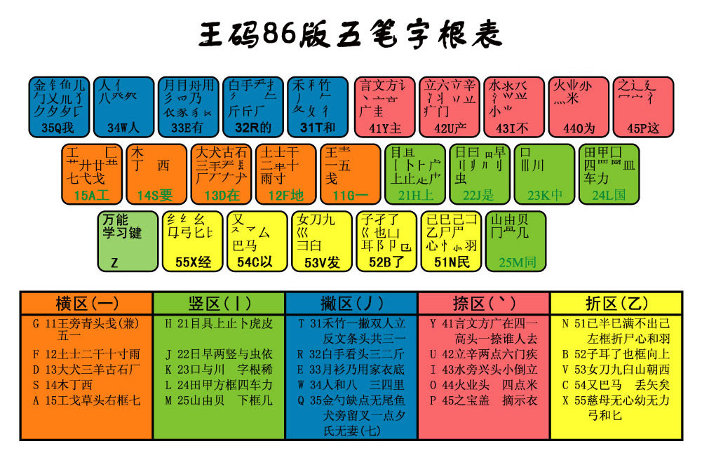

= 五笔86学习


== 五笔86字根表
.字根表


== 五笔86末笔表
[cols="^1,^1,^1,^1", options="header", frame="all", grid="all"]
|===
|{nbsp} |左右型 |上下型 |杂合型

|1-横 |11-G |12-F |13-D
|2-竖 |21-H |22-J |23-K
|3-撇 |31-T |32-R |33-E
|4-捺 |41-Y |42-U |43-I
|5-折 |51-N |52-B |53-V
|===

== 五笔86难字表
https://wubi.xuelai.com/

```
anh 蔬
egc 县
glf 盏
mfd 冉 -- 最后一笔为橫，杂合结构
rtth 斤
tak 升
uhk 丫
xfm 贯 -- 都是字根码
```

== 五笔86一级简码
[cols="10*1", options="header"]
|===
|Q |W |E |R |T |Y |U |I |O |P
|我|人|有|的|和|主|产|不|为|这

|A |S |D |F |G |H |J |K |L
|工|要|在|地|一|上|是|中|国

|X |C |V |B |N |M
|经|以|发|了|民|同
|===

